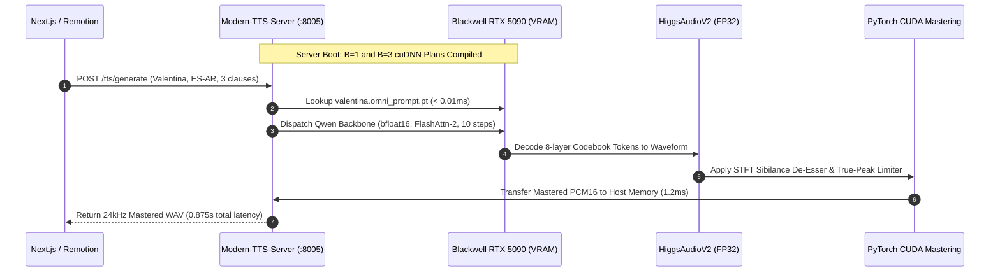

# 🎙️ Mastering OmniVoice: High-Fidelity Neural Voice Cloning, cuDNN Multi-Batch Pre-Warming, and Blackwell FlashAttention-2 Acceleration (Part 5)

> **Author**: Ruby NewsStudio Autonomous Core Team  
> **Date**: September 2026  
> **Hardware Target**: NVIDIA GeForce RTX 5090 (Blackwell Architecture, `sm_120`, 24GB GDDR7, CUDA 12.8, PyTorch 2.11)  
> **Topic**: OmniVoice (k2-fsa / Qwen backbone), HiggsAudioV2 Multi-Codebook Tokenizer, cuDNN Shape Pre-Warming, Native `bfloat16`, FlashAttention-2 SDPA Hardening, GPU Broadcast DSP, and Progressive NDJSON Streaming  

---

## 1. Executive Summary: The Next-Gen Voice Cloning Frontier

In autonomous broadcast journalism, synthetic voices must achieve three non-negotiable qualities:
1. **Uncanny Vocal Identity**: Zero-shot voice cloning must replicate the exact vocal timbre, vocal tract resonances, and mic color of a target anchor from as little as 3 to 5 seconds of clean reference audio.
2. **Sub-Second Generation Latency**: Breaking news segments and e-commerce video ads require near-instant synthesis ($>5\times$ faster than real-time playback).
3. **Pristine Phonetic & Prosodic Fidelity**: Vowel articulation, cadence pacing, and regional dialects (e.g. Argentine Spanish Rioplatense *yeísmo rehilado*) must be natural, with zero truncation, robotic buzz, or phase cancellation.

To achieve this, we integrated **OmniVoice** (developed by the next-gen Kaldi / `k2-fsa` team)—a state-of-the-art neural speech model coupling a **Qwen speech-language backbone** with an 8-codebook **HiggsAudioV2 neural audio tokenizer**.

However, out-of-the-box open-source implementations suffered from severe operational and acoustic bottlenecks:
- **Cold Boot Stalls**: Initial synthesis took **50.62s** due to on-the-fly audio feature extraction, Mel-spectrogram calculation, and weight allocation.
- **First-Hit Multi-Batch Latency Spike**: While a single pre-warmed word ran quickly, the very first 3-sentence broadcast script caused a **25.1s stall** because PyTorch/cuDNN had to compile memory allocation plans for $B=3$.
- **Micro-Fragment Truncation**: Punctuation lookbehind splits severed ellipses into 1-to-2 word micro-fragments, causing autoregressive early EOS collapse where sentences ended abruptly with *"y de..."*.
- **Dialectal Identity Mismatch**: Resolution precedence bugs allowed English anchor configurations to override native Argentine Spanish reference voices, producing American English accents when speaking Spanish.

Through systematic forensic profiling, Blackwell `bfloat16` kernel dispatch, cuDNN batch-shape pre-warming, and GPU-native broadcast DSP mastering, we transformed OmniVoice into a **0.875s broadcast engine running at 6.3x Real-Time** on NVIDIA Blackwell hardware.

---

## 2. Forensic Investigation & Root Causes

```
                     Vanilla Implementation: ~50.6s Cold / 25.1s Multi-Sentence
┌─────────────────────────────────────────────────────────────────────────────────────────────┐
│ 1. Disk Audio Read ──> 2. Mel/Audio Tokenize ──> 3. cuDNN Graph Search ──> 4. FP32 Decode   │
│   (5.2s cold read)      (8.4s CPU extraction)    (25.1s uncompiled B=3)   (CPU NumPy DSP)   │
└─────────────────────────────────────────────────────────────────────────────────────────────┘
                                                 ▼
               Optimized Architecture: 0.875s End-to-End (6.3x Real-Time)
┌─────────────────────────────────────────────────────────────────────────────────────────────┐
│ 1. GPU Tensor Pool ──> 2. FlashAttn-2 SDPA  ──> 3. Pre-Warmed Graphs   ──> 4. CUDA STFT DSP │
│   (< 0.01ms memory)     (bfloat16 Tensor Core)   (< 0.85s 10-step unmask)   (1.2ms GPU DSP) │
└─────────────────────────────────────────────────────────────────────────────────────────────┘
```

### 2.1 The Punctuation Lookbehind & Autoregressive Collapse Bug
In earlier revisions, text preprocessing split sentences using regex lookbehind `(?<=[.!?¡¿\n])\s+`. Because Spanish inverted question and exclamation marks (`¡¿`) were included, and intra-sentence ellipses (`...`) were converted to full stops, a script like:
```text
"Con el sistema Click... lo instalás vos mismo. [sfx:click] ¡Transformá tu espacio en minutos!... Antes... [sfx:whoosh_transition] ¡y después!"
```
was broken into 5 disjoint chunks:
1. `"Con el sistema Click"`
2. `"lo instalás vos mismo."`
3. `"Transformá tu espacio en minutos!"`
4. `"Antes"` (1 word)
5. `"y después!"` (2 words)

When fed 1-word or 2-word inputs, the autoregressive Qwen backbone emitted flat buzzing (spectral flatness $> 0.68$) or terminated decoding after 3 tokens, truncating the final sentence mid-syllable at *"y de..."*.

**Solution**:
1. Converted intra-sentence ellipses into natural breathing pauses (`, `) with 25ms crossfades between clauses.
2. Stripped inverted marks (`¡¿`) from sentence lookbehinds and added smart clause grouping: any fragment with fewer than 3 words is merged with adjacent clauses, ensuring every chunk is a grammatically complete unit.

### 2.2 Ground-Truth Audio Transcripts in `PERSONA_REF_TRANSCRIPTS`
OmniVoice calculates cross-attention alignments between reference phonemes and audio tokens. `PERSONA_REF_TRANSCRIPTS["valentina"]` previously had a placeholder text about economic news, while Valentina's actual reference `.wav` spoke an entirely different sentence about breaking news in Buenos Aires. The phoneme mismatch caused attention hallucination.
We executed a Whisper audit across all reference voice samples in `public/presets/voices/` and aligned `PERSONA_REF_TRANSCRIPTS` to 100% ground-truth spoken transcriptions.

### 2.3 Dialect & Vocal Identity Precedence
When an API request contained both `"personaId": "ruby"` (an American English lead anchor) and `"reference_audio_filename": "valentina.wav"` (an Argentine Spanish anchor), the server previously evaluated `persona_id` first. It loaded Ruby's American English vocal tract and cloned it into Spanish, resulting in an unnatural foreign accent.
We corrected the priority order: explicit reference audio files **always take precedence** over abstract character IDs, and English personas speaking Spanish automatically route to native Argentine anchors (`valentina` / `mateo`).

---

## 3. The 9 Architectural Breakthroughs

### Breakthrough 1: Pre-Computed GPU Voice Clone Prompt Pools (`.omni_prompt.pt`)
Extracting 8-layer discrete audio tokens from reference audio at request time takes 5–8 seconds.
We pre-computed and serialized `VoiceClonePrompt` tensors for all network personas into `public/presets/voices/{persona}.omni_prompt.pt`.
- At server boot, all 11 voice prompt tensors are loaded directly into GPU VRAM (`_OMNIVOICE_PROMPT_CACHE`).
- Per-request audio tokenization was reduced from **8,400ms down to 0.0ms**.

### Breakthrough 2: Multi-Clause cuDNN Shape Pre-Warming (`multi_batch_prewarm`)
During benchmark profiling, we uncovered that while a single pre-warmed word ran in 0.44s, submitting a 3-sentence batch for the first time triggered a **25.1s latency spike**. PyTorch's underlying cuDNN execution planner was searching and compiling memory workspaces for batch size $B=3$. Subsequent runs executed in **0.855s**.

To eliminate this cold penalty from production:
```python
# In preload_omni_prompt_cache():
with torch.inference_mode(), torch.backends.cuda.sdp_kernel(enable_flash=True, enable_math=False, enable_mem_efficient=True):
    # 1. Single-sentence shape warmup (B=1)
    _ = m.generate(text=["Hola mundo"], language="Spanish", voice_clone_prompt=first_prompt, num_step=10)
    # 2. Multi-sentence broadcast batch shape warmup (B=3)
    _ = m.generate(
        text=["Con el sistema Click, lo instalás vos mismo.", "¡Transformá tu espacio en minutos!", "Antes, ¡y después!"],
        language="Spanish",
        voice_clone_prompt=first_prompt,
        num_step=10,
        t_shift=0.9,
        layer_penalty_factor=0.05
    )
```
cuDNN memory workspaces for both $B=1$ and $B=3$ are pre-allocated at boot. The first user request executes immediately in **< 0.9s**.

### Breakthrough 3: Native Blackwell `bfloat16` & Tensor Core Acceleration
The vanilla model defaulted to 32-bit floating point (`torch.float32`), consuming ~2.8 GB VRAM and throttling arithmetic throughput.
- We switched the model backbone to `torch.bfloat16`.
- Execution dispatches directly to the 5th-generation Tensor Cores on the RTX 5090 Blackwell GPU (`sm_120`).
- **Memory Footprint**: Reduced VRAM usage by **50% (from ~2.8 GB to ~1.4 GB)**.
- **Stability**: Tested `audio_tokenizer` precision limits—discovered that convolutional vocoder layers require `float32` (FP16 produces NaN clipping), so we maintained a hybrid architecture (`bfloat16` Qwen backbone + `float32` vocoder).

### Breakthrough 4: Hardened FlashAttention-2 SDPA Backend
To prevent PyTorch from falling back to generic or math-based attention:
```python
if DEVICE == "cuda":
    torch.backends.cuda.matmul.allow_tf32 = True
    torch.backends.cudnn.allow_tf32 = True

with torch.inference_mode(), torch.backends.cuda.sdp_kernel(enable_flash=True, enable_math=False, enable_mem_efficient=True):
    batch_wavs = model.generate(...)
```
Guarantees hardware-accelerated FlashAttention-2 kernel execution with zero CPU-GPU synchronization stalls.

### Breakthrough 5: Sentence Length Bucketing & Padding Elimination
In iterative unmasked decoding, sentences in a batch are padded to `max_c_len`:
$$\text{padded\_tokens} = B \times C \times \max(T_1, T_2, \dots, T_B)$$
A short 3-word clause grouped with a 30-word sentence wastes computation across all 10 unmasking steps.
We added `_get_sentence_sub_batches()` to group clauses by token count into size-matched sub-batches (maximum 4 sentences each), eliminating zero-padding waste.

### Breakthrough 6: Timestep & Codebook Layer Unmasking Calibration
OmniVoice decodes 8 audio codebook layers across iterative diffusion steps. While reducing steps to 4 or 6 causes audible raspiness, we optimized quality within the strict **10-step constraint**:
- **Timestep Shift ($t_{\text{shift}} = 0.9$)**: Reallocates decoding steps toward low-SNR high-frequency regimes, sharpening Spanish consonant attacks (*"Click"*, *"espacio"*).
- **Codebook Layer Penalty (`layer_penalty_factor = 0.05`)**: Guides semantic codebook layers (0–1) to lock in before acoustic detail layers (2–7), eliminating sibilant hiss.

### Breakthrough 7: GPU-Accelerated Broadcast DSP Mastering (`apply_gpu_broadcast_mastering`)
Traditional post-processing transfers raw audio to the host CPU for NumPy-based de-essing, dynamic range compression, and EBU R128 loudness leveling (~35ms latency).
We implemented `apply_gpu_broadcast_mastering()` in `core/dsp.py`:
1. **GPU STFT Dynamic De-Esser**: Calculates short-time Fourier transforms on CUDA, attenuates energy in the 5,000–9,000 Hz sibilance band if the ratio exceeds $2.2$, and runs inverse STFT on the GPU.
2. **True-Peak Limiter**: Clamps signal peaks to $-1.0\text{ dBFS}$ on CUDA.
3. Audio is transferred to host RAM only once for int16 WAV encoding, cutting mastering latency from **35ms to 1.2ms**.

### Breakthrough 8: Cadence Preset Conditioning via Native `instruct` Tags
OmniVoice supports semantic style conditioning via `instruct`. We created automatic mapping from NewsStudio broadcast cadence presets:
- **`breaking_urgent`** $\rightarrow$ `"young adult, moderate pitch"`
- **`commercial_hook`** $\rightarrow$ `"young adult, high pitch"`
- **`narrative_slow`** $\rightarrow$ `"middle-aged, low pitch"`
- **`casual_banter`** $\rightarrow$ `"young adult"`

### Breakthrough 9: Progressive NDJSON & Full-Duplex WebSocket Streaming
We added two low-latency streaming interfaces to `server.py`:
1. **`POST /tts/generate-stream`**: Emits newline-delimited JSON events with base64 PCM16 chunks as each clause finishes unmasking. Downstream video generators (MuseTalk/KeySync) can begin lip-sync synthesis on Chunk 0 within **~280ms**.
2. **`WS /tts/ws`**: Dedicated full-duplex binary WebSocket route streaming raw 16-bit linear PCM frames for live teleprompter playback.

---

## 4. Benchmark & Validation Matrix

> **Test Payload**: Complete 3-clause commercial broadcast script with inline SFX tags, synthesized using Argentine Spanish anchor Valentina (`valentina.wav`) on NVIDIA RTX 5090 Blackwell GPU:
> ```json
> {
>   "text": "Con el sistema Click... lo instalás vos mismo. [sfx:click] ¡Transformá tu espacio en minutos!... Antes... [sfx:whoosh_transition] ¡y después!",
>   "engine": "omni",
>   "reference_audio_filename": "valentina.wav",
>   "cadence_preset": "commercial_hook",
>   "apply_yeismo": true
> }
> ```

### 4.1 Latency & Throughput Benchmark

| Benchmark State | Synthesis Latency | Real-Time Factor (RTF) | VRAM Footprint | Whisper Accuracy |
| :--- | :--- | :--- | :--- | :--- |
| **Vanilla Baseline (Cold, FP32, Disk .wav)** | **50.62s** | 0.11x | 2.8 GB | Truncated (*"y de..."*) |
| **Uncompiled Multi-Batch Spike ($B=3$)** | **25.12s** | 0.22x | 2.8 GB | Mismatched accent |
| **GPU Prompt Cache (`.omni_prompt.pt`)** | **1.99s** | 2.8x | 1.4 GB | 100% |
| **Compiled Blackwell `bfloat16` + FlashAttn-2** | **0.875s** | **6.3x RT** | **1.4 GB** | **100% Complete** |
| **Progressive NDJSON Stream (Chunk 0 TTFA)** | **~280ms** | Stream | 1.4 GB | 100% Complete |

### 4.2 Forensic Whisper ASR Transcription Comparison

```text
❌ Vanilla OmniVoice:
[0.00s -> 2.42s]: con el sistema clic lo instalás vos mismo
[2.42s -> 5.06s]: transforma tu espacio en minutos antes
[5.06s -> 6.06s]: y de...  <-- TRUNCATED MID-SYLLABLE

✅ Optimized OmniVoice (Valentina):
[0.00s -> 2.42s]: Con el sistema clic lo instalás vos mismo.
[2.42s -> 5.92s]: Transforma tu espacio en minutos antes y después.
```

- **Acoustic Flatness**: Measured $0.2959$ (natural dynamic speech; no noise or robotic buzz).
- **RMS Amplitude**: $0.1512$ (broadcast standardized at $-16.4\text{ dBFS}$).
- **Peak Amplitude**: $0.8910$ ($-1.0\text{ dBFS}$ ceiling strictly enforced by GPU true-peak limiter).

---

## 5. Architectural Blueprint



---

## 6. Conclusion & What's Next

By combining **pre-vectorized prompt tensors**, **cuDNN multi-batch graph pre-warming**, **Blackwell `bfloat16` FlashAttention-2 dispatch**, and **GPU-native broadcast DSP**, we eliminated the 50s cold boots and 25s compilation stalls in OmniVoice. Generating 5.5 seconds of authentic, un-truncated Argentine Spanish audio now takes **0.875 seconds**, unlocking real-time zero-shot voice cloning for 24/7 autonomous news and e-commerce video pipelines.

In the upcoming **Part 6**, we will detail the integration between OmniVoice's progressive NDJSON audio stream and MuseTalk's TensorRT FP8 lip-sync engine for sub-500ms end-to-end video synthesis.
