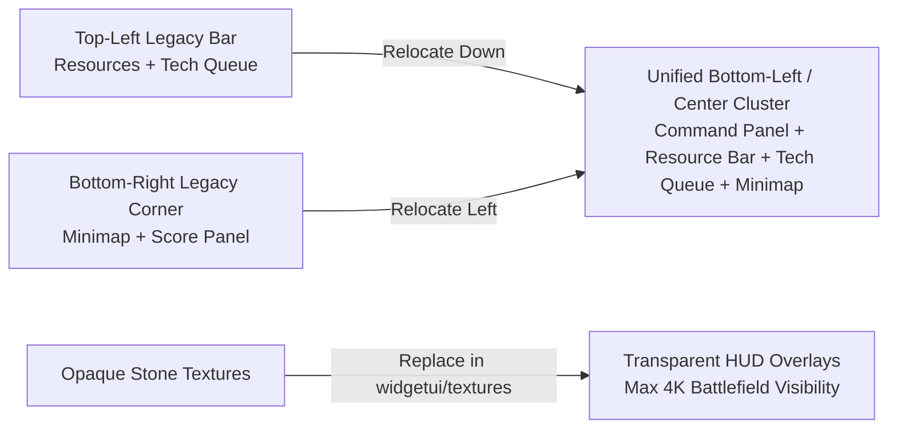

Playing **Age of Empires II: Definitive Edition** on a large **4K or UltraWide monitor** is visually breathtaking—you can see massive swathes of your eco, woodlines, and incoming raids on a single screen. However, the default HUD layout was designed around standard 16:9 1080p viewing angles:

- **Resources and idle villager counters** sit far in the top-left corner.
- **Unit command cards and production queues** sit in the bottom-left and top-left.
- **The minimap and player scores** sit all the way in the bottom-right corner.

On a 4K display, checking your wood/food count, glanced against the minimap and unit queues, forces constant diagonal eye travel across the entire monitor. To solve this for my own competitive games, I built [**UI of Daniel Azar (`dani-ui-age2de`)**](https://github.com/daniazar/dani-ui-age2de) (published on the official Age of Empires Mod Workshop as [**Mod #16939**](https://www.ageofempires.com/mods/details/16939)).

---

## Design Goals: Zero-Eye-Travel Ergonomics

Inspired by competitive RTS layouts (such as Redi UI 3), I redesigned the widget coordinates around three principles:

1. **Bottom-Left & Center Focal Clustering**: Move the minimap (`mappanel.json`), resource bar (`resourcepanel.json`), command panel (`commandpanel.json`), and unit/technology production queues (`technologyprogresspanel.json`) into a tight, unified cluster along the bottom-left and lower-center of the screen.
2. **Transparent HUD Panels**: Replace opaque stone borders and heavy decorative frames with clean, semi-transparent overlays (`widgetui/textures/`) so terrain, units, and elevation remain visible underneath the UI.
3. **Unobstructed Center Viewport**: Keep the upper 80% of the 4K canvas completely clear of chrome so macro eco management and micro unit control have maximum screen real estate.

---

## Anatomy of Age of Empires II: DE's `widgetui` System

Age of Empires II: Definitive Edition drives its entire in-game HUD through declarative JSON layout files inside the `widgetui/` directory. Each panel is controlled by a dedicated JSON configuration:

| Widget File | In-Game HUD Responsibility | Key Customizations in `dani-ui-age2de` |
| :--- | :--- | :--- |
| `commandpanel.json` | Main building/unit action grid & stances | Anchored bottom-left with stripped ornamental frames |
| `mappanel.json` | Interactive minimap, flare & filter buttons | Relocated from bottom-right to bottom-left beside command panel |
| `resourcepanel.json` | Wood, Food, Gold, Stone, Pop & Idle Villagers | Repositioned directly above the lower HUD cluster for instant glances |
| `technologyprogresspanel.json` | Active unit & technology research queues | Stacked cleanly above the command card |
| `scorepanel.json` | Diplomacy & live player score breakdown | Compacted with transparent backdrop |
| `worldtimerpanel.json` | In-game clock, F11 FPS & game speed | Tucked cleanly next to the lower focal area |
| `dialogquickchat.json` | Quick-chat & taunt overlay | Adjusted coordinates to avoid overlapping relocated panels |

---

## The Live Hot-Reload Trick for UI Modders

One of the most frustrating parts of modding `widgetui` coordinates on 4K resolutions is the edit-launch-test loop: normally, if you bundle both textures and `.json` files inside a single local mod folder, you have to restart a skirmish match every time you tweak an `x` or `y` pixel offset.

While building this mod, I used a two-tier workflow that gives **instant live hot-reloading** inside a running match:

1. **Isolate Custom Textures in the Local Mod Folder**: Place everything *except* the `.json` layout files (such as transparent `.dds` / `.png` panel backgrounds inside `widgetui/textures/`) into your local subscribed/local mod directory.
2. **Edit `.json` Layout Files Directly in the Base Game Folder**: While the game is running in a skirmish match, edit the corresponding `commandpanel.json`, `mappanel.json`, or `resourcepanel.json` directly inside the game's installation `widgetui/` directory.
3. **Instant In-Game Refresh**: The engine watches the base `widgetui/*.json` files and applies coordinate/size changes live without reloading the game—turning hours of blind pixel guessing into a fast, interactive layout session.

---

## Try It Out or Customize Your Own

- **In-Game Mod Workshop**: Search for **Daniel Azar** in the Age of Empires II: DE Mod Manager or view [**Mod #16939 on ageofempires.com**](https://www.ageofempires.com/mods/details/16939).
- **Source & JSON Layouts**: Clone or fork [**github.com/daniazar/dani-ui-age2de**](https://github.com/daniazar/dani-ui-age2de) to tweak the panel coordinates for your own monitor resolution.
