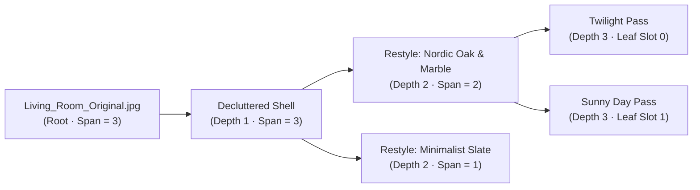

When an architect, interior designer, or real estate stager uses generative AI to renovate a property photo, **creative exploration is never linear**.

Suppose you upload a raw photograph of a dated living room (`Living_Room_Original.jpg`). First, you run a **Smart Declutter** pass to strip away the old furniture while locking the windows and structural beams. From that clean architectural shell, you want to explore three completely different buyer personas:
1. **Branch A**: *Nordic Oak flooring + Calacatta Marble countertops* $\longrightarrow$ followed by a *Golden-Hour Twilight* lighting pass.
2. **Branch B**: *Minimalist Microcement + Matte Black fixtures* $\longrightarrow$ followed by a *Sunny Day* pass.
3. **Branch C**: *Warm Mediterranean Terracotta* $\longrightarrow$ followed by a *Freeform AI Skylight* edit.

In a traditional editor with a linear `Undo / Redo` stack, backing up to the `Decluttered Shell` and generating Branch B destroys or buries Branch A.

To solve this in **[ArchitecturaAI](https://github.com/daniazar/real-estate-renovation-studio)**, we engineered a dedicated **`NODES` Image Tree Versioning Mode** (`components/transformation-canvas.tsx` and `lib/stores/canvas-store.ts`) right alongside the standard `DESIGN` viewport.


---

## 1. Relational Lineage via `parentImageId`

At the database and state layer (`lib/types.ts`), every `Image` record in a project folder carries a nullable self-referential foreign key `parentImageId` alongside its transformation metadata:

```typescript
export type TimeOfDay = "sunny" | "twilight" | "night";
export type TransformationType = "restyle" | "declutter" | "lighting" | "freeform";

export interface Image {
  id: string;
  projectId: string;
  folderId: string | null;
  parentImageId: string | null; // null = Original Source Upload (Tree Root)
  name: string;
  imageUrl: string;
  thumbnailUrl: string | null;
  transformationType: TransformationType | null;
  transformationConfig: {
    timeOfDay?: TimeOfDay;
    materials?: { id: string; name: string; category: string; color: string }[];
    declutterOptions?: {
      removeFurniture: boolean;
      removeWallArt: boolean;
      removePlants: boolean;
      removeAccessories: boolean;
    };
  } | null;
}
```

* **Root Nodes (`parentImageId === null`)**: Original photographs uploaded from the camera or listing folder.
* **Child Nodes (`parentImageId !== null`)**: Every time a user triggers `Apply Transformation` in either the `DESIGN` view or directly from the `NODES` canvas prompt bar, the resulting image is persisted with `parentImageId` pointing to the currently active source image.
* **Zero-Cost Branching**: Selecting any intermediate node in the tree and running a new pass automatically creates a sibling branch without duplicating or mutating ancestor states.

---

## 2. Building the Tree & Guarding Against Corrupted Cycles

When switching the editor header toggle from `DESIGN` to `NODES`, `useCanvasStore.buildTreeFromImages(images, rootImageId)` converts the flat folder image array into an in-memory adjacency tree (`buildTree`) and runs a depth-first cycle detector (`detectCycle`):

```typescript
function buildTree(nodes: TransformationNode[]): { roots: TreeItem[]; hasCycle: boolean } {
  const map: Record<string, TreeItem> = {};
  const roots: TreeItem[] = [];
  let hasCycle = false;

  for (const n of nodes) {
    map[n.id] = { node: n, children: [] };
  }

  for (const n of nodes) {
    if (n.parentId && map[n.parentId]) {
      if (n.parentId === n.id) {
        hasCycle = true;
        roots.push(map[n.id]);
        continue;
      }
      map[n.parentId].children.push(map[n.id]);
    } else {
      roots.push(map[n.id]);
    }
  }

  const detectCycle = (item: TreeItem, visited: Set<string>): boolean => {
    if (visited.has(item.node.id)) return true;
    visited.add(item.node.id);
    for (const child of item.children) {
      if (detectCycle(child, new Set(visited))) return true;
    }
    return false;
  };

  for (const root of roots) {
    if (detectCycle(root, new Set())) {
      hasCycle = true;
      break;
    }
  }

  return { roots, hasCycle };
}
```

---

## 3. The Recursive Subtree-Span Layout Algorithm

Rather than pulling in a heavyweight external graph layout dependency like Dagre or ELK just to position transformation trees, we wrote a deterministic **Recursive Subtree-Span Layout Engine** (`layoutHorizontal` and `layoutVertical`) in under 60 lines of TypeScript.



### How It Works

1. **Compute Leaf Span (`subtreeSpan`)**:
   Every leaf node occupies $1$ unit slot. Every internal node's span is the sum of the spans of its children:
   $$\text{span}(u) = \begin{cases} 1 & \text{if } \text{children}(u) = \emptyset \\ \sum_{v \in \text{children}(u)} \text{span}(v) & \text{otherwise} \end{cases}$$
2. **Center Parents Over Their Subtree Slot Range**:
   At tree depth $d$ and starting leaf slot $s_0$, a node with span $S = \text{span}(u)$ is placed at the exact midpoint of its children's vertical (or horizontal) span:
   $$\text{midSlot} = s_0 + \frac{S}{2} - 0.5$$
   $$x = x_0 + d \cdot (\text{NODE\_W} + \text{GAP\_X}), \quad y = y_0 + \text{midSlot} \cdot (\text{NODE\_H} + \text{GAP\_Y})$$
3. **Partition Slots Across Children**:
   Each child $v_i$ is recursively assigned the contiguous sub-interval $[s_i, s_i + \text{span}(v_i))$, guaranteeing that **no two subtrees can ever collide or cross edges**, regardless of tree depth or branching factor!

---

## 4. Animated Cubic-Bezier SVG Edges & Semantic Badges

In `TransformationCanvas` (`components/transformation-canvas.tsx`), edges and nodes are rendered in a synchronized pan-and-zoom coordinate space (`canvasOffset`, `canvasZoom` from `0.1x` to `3.0x`) with one-click switching between **Horizontal (`LR`)** and **Vertical (`TB`)** tree orientations:

* **Cubic-Bezier Connectors (`CanvasEdge`)**:
  In horizontal layout, each edge connects the right connector port of the parent `(from.x + NODE_W, from.y + NODE_H / 2)` to the left connector port of the child `(to.x, to.y + NODE_H / 2)` via a smooth SVG cubic Bezier curve `M x1 y1 C midX y1, midX y2, x2 y2` animated with Framer Motion (`pathLength: 0 -> 1`).
* **Semantic Operation Badges (`getBadgeColor`)**:
  Each node card displays its lightweight WebP thumbnail (`thumbnailUrl`), editable title, and a color-coded badge indicating the exact AI operation that produced that child:
  * **Emerald (`bg-emerald-500/90`)**: `Restyle: Nordic Oak...`
  * **Rose (`bg-rose-500/90`)**: `Declutter`
  * **Amber (`bg-amber-500/90`)**: `Twilight` / `Sunny` / `Night` lighting passes
  * **Violet (`bg-violet-500/90`)**: `Free Transformation` prompt edits
* **Direct Canvas-to-Editor Handoff**:
  Double-clicking or clicking the `Open in Design View` action button on any node in the tree immediately loads that exact historical variation into the main `DESIGN` split-screen comparison editor.
