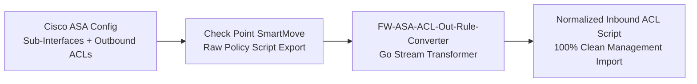

During enterprise security migrations at [**MoltenMinds**](https://moltenminds.com/), one of the most error-prone operational tasks we encountered was migrating legacy **Cisco ASA** perimeter and data-center firewalls over to **Check Point VSX (Virtual System Extension)** appliances.

When a data center firewall has accumulated years of VLAN sub-interfaces (`Port-channel1.340`), hundreds of static routes, and thousands of Access Control Lists (ACLs), migrating those policies by hand is a recipe for midnight outages. Even worse, vendor migration tools like **Check Point SmartMove** choke or drop policies when encountering **Cisco ASA outbound ACL rules (`access-list ... out`)**, because Check Point's policy model evaluates interface directionality differently during import.

To eliminate manual translation errors and turn multi-day migration windows into repeatable 5-second builds, we engineered two open-source CLI tools in **Go**:
1. [**`ASAtoVSXParser`**](https://github.com/MoltenMinds/ASAtoVSXParser) — Parses raw Cisco ASA configuration dumps into structured JSON interface and routing tables ready for Check Point VSX provisioning.
2. [**`FW-ASA-ACL-Out-Rule-Converter`**](https://github.com/MoltenMinds/FW-ASA-ACL-Out-Rule-Converter) — Rewrites SmartMove-exported ASA Outbound ACL rules into equivalent Inbound route-aware policy scripts so Check Point management servers import 100% of the rulebase cleanly.

---

## Problem 1: Extracting Virtual Interfaces & Routes (`ASAtoVSXParser`)

A typical Cisco ASA configuration interleaves physical port channels, VLAN sub-interfaces, security levels, `nameif` aliases, and static routes across thousands of lines:

```text
interface Port-channel1.340
  description INSIDE_93_DCINT_MAN_RFG_MINTRANS_EXCH
  vlan 340
  nameif INSIDE_93_DCINT_MAN_RFG_MINTRANS_EXCH
  security-level 30
  ip address 10.240.115.98 255.255.255.248

route OUTSIDE 0.0.0.0 0.0.0.0 181.209.69.246 1
```

In [**`ASAtoVSXParser`**](https://github.com/MoltenMinds/ASAtoVSXParser), we built a single-pass line scanner in Go (`runner.go`) that tokenizes interface stanzas and `route` declarations into strongly typed `models.Port` and `models.Route` structs, correlating each `nameif` alias with its CIDR netmask and VLAN tag, and emitting clean `-interfaces.json` and `-routes.json` artifacts for automated VSX provisioning.

---

## Problem 2: The Outbound ACL Trap in Check Point SmartMove

When you run **Check Point SmartMove (`v5.1+`)** against a Cisco ASA configuration that relies heavily on **Outbound ACLs** (rules attached to an egress interface via `access-group ... out interface ...`), SmartMove flags or fails to import those rules cleanly because standard gateway rulebases expect ingress-normalized topology mappings.



To solve this without manually rewriting hundreds of firewall rules:
- [**`FW-ASA-ACL-Out-Rule-Converter`**](https://github.com/MoltenMinds/FW-ASA-ACL-Out-Rule-Converter) ingests the script generated by Check Point SmartMove.
- It scans the header, rulebase, and footer boundaries, automatically transforming **ASA Outbound ACL rules** into normalized **Inbound route rules** while preserving source/destination networks, service ports, logging flags, and rule ordering.
- The resulting `-output.txt` script can be executed directly on the **Check Point Management Server** to create the complete policy package with zero import errors.

---

## Why Go for SecDevOps Tooling?

For network security engineers working inside locked-down jump hosts and air-gapped management networks, Python or Node.js scripts that require installing external runtime dependencies (`pip` / `npm`) are a non-starter. Compiling our parsers in **Go** using only the standard library (`bufio`, `os`, `strings`, `encoding/json`) meant we could cross-compile a single zero-dependency static binary (`GOOS=windows` or `GOOS=linux`), drop it onto any migration workstation, and process tens of thousands of firewall lines in milliseconds.

Both tools are available on the MoltenMinds GitHub organization:
- [**github.com/MoltenMinds/ASAtoVSXParser**](https://github.com/MoltenMinds/ASAtoVSXParser)
- [**github.com/MoltenMinds/FW-ASA-ACL-Out-Rule-Converter**](https://github.com/MoltenMinds/FW-ASA-ACL-Out-Rule-Converter)
