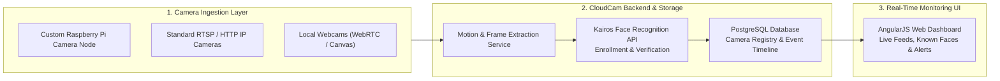

Back in 2015, consumer security cameras were mostly passive DVR boxes—they could record hours of motion-triggered footage to an SD card or FTP server, but they couldn't tell the difference between a family member arriving home, a stray cat, or an unknown intruder.

To explore smart home automation and cloud biometrics, I built **CloudCam**—a unified smart security camera platform with **real-time face recognition**, supporting standard USB webcams, RTSP/HTTP IP cameras, and a custom **Raspberry Pi hardware camera prototype**.

---

## System Architecture: Edge Capture + Cloud Biometrics

CloudCam was designed around a three-tier architecture so inexpensive edge cameras could offload heavy biometric matching to a central backend:

### 1. Universal Camera Ingestion & Raspberry Pi Node
Instead of locking users into proprietary camera hardware, CloudCam allowed registering three types of video sources in a single dashboard:
- **Custom Raspberry Pi Prototype**: A standalone Linux edge node equipped with the Raspberry Pi Camera Module that captured frames on motion events and streamed snapshots to the CloudCam server.
- **IP Cameras**: Any standard network camera exposing an MJPEG or snapshot stream.
- **Browser Webcams**: Instant zero-hardware testing directly from a laptop or spare phone camera.

### 2. Biometric Enrollment & Recognition via Kairos
When CloudCam detected a person in frame, it extracted the image and dispatched it to the **Kairos Face Recognition** pipeline:
- **Subject Enrollment**: Users could upload or tag reference photos of trusted family members or employees from the AngularJS dashboard to build a private gallery.
- **Real-Time Identification**: Incoming camera frames were matched against the enrolled gallery, logging confidence scores, timestamps, and bounding-box snapshots in **PostgreSQL** and triggering instant alerts when an unrecognized face was detected.

---

## Video Walkthrough

You can watch the full live demonstration of the CloudCam web dashboard, face enrollment workflow, and Raspberry Pi camera prototype on YouTube:
- [**Watch the CloudCam Demo on YouTube**](https://youtu.be/tSpp2GaxFvQ)
