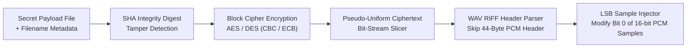

While cryptography focuses on making a message **unreadable** to an eavesdropper, **steganography** focuses on making the very **existence of the message invisible**. When you combine both—encrypting a secret payload with strong block ciphers and embedding the resulting ciphertext inside an innocent carrier medium—an attacker inspecting network traffic sees only an ordinary media file.

Back in 2011, Gustavo Maldonado and I built [**Crypto Audio Steganography (`cripto2011`)**](https://github.com/daniazar/cripto2011) in **C**: a command-line cryptography and steganography engine that encrypts arbitrary files using **AES** or **DES**, computes **SHA** integrity digests, and conceals the binary stream inside uncompressed **PCM `.wav` audio files**.

---

## Why Uncompressed WAV Audio Makes an Ideal Carrier

A standard CD-quality stereo `.wav` file sampled at $44.1\text{ kHz}$ with $16\text{-bit}$ signed PCM samples contains:

$$44{,}100 \times 2 \text{ channels} = 88{,}200 \text{ samples per second}$$

Because human hearing cannot perceive a $\pm 1$ quantization change in a $16\text{-bit}$ amplitude sample ($[-32768, 32767]$), replacing the **Least Significant Bit (LSB)** of each sample introduces an imperceptible noise floor at roughly $-96\text{ dB}$ while providing **$88.2\text{ kilobits}$ ($\approx 11\text{ KB}$) of covert storage capacity per second of audio**—over $1.9\text{ MB}$ of hidden payload inside a typical 3-minute song!

---

## Two-Stage Pipeline: Encrypt First, Embed Second

Embedding raw plaintext bits directly into LSB audio samples is dangerous: statistical steganalysis or simple bit-plane extraction would immediately reveal ASCII headers or file magic bytes. To prevent this, `cripto2011` enforces a strict **Encrypt-then-Embed** pipeline:

1. **RIFF/WAV Header Parsing in C**: The parser reads the 44-byte RIFF/WAVE header cleanly in C structs, verifying that the carrier is uncompressed PCM (`AudioFormat == 1`) and calculating exact available bit capacity from `Subchunk2Size` before touching a single audio sample.
2. **Cryptographic Envelope (AES / DES + SHA)**: The secret file is hashed with **SHA** to guarantee integrity upon extraction and encrypted with **AES** or **DES** so the resulting bit-stream is statistically indistinguishable from uniform random noise.
3. **LSB Bit-Plane Injection & Extraction**: After the 44-byte WAV header, the encoder masks and replaces the least significant bit(s) of each 16-bit audio sample (`(sample & ~1) | payload_bit`). On the receiving end, the extractor reconstructs the ciphertext bit-by-bit, decrypts it with the symmetric key, and verifies the SHA digest to confirm zero bit-corruption.

The C source code is archived on GitHub at [**github.com/daniazar/cripto2011**](https://github.com/daniazar/cripto2011).
