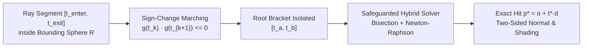

In [**Part 1**](/posts/isurfer-part-1-why-raytracing-beats-triangle-meshes-for-algebraic-surfaces) of this series, we examined why polygon meshes (Marching Cubes) break down at the conical singularities and self-intersections of algebraic surfaces $f(x, y, z) = 0$. In [**Part 2**](/posts/isurfer-part-2-equation-parser-ast-and-on-the-fly-glsl-compiler), we built the recursive-descent parser and AST-to-GLSL compiler that JIT-compiles user equations into native GPU functions `float f(vec3 p)` and `vec3 grad_f(vec3 p)` on the fly.

In this final installment (**Part 3**), we step inside the **OpenGL ES 2.0 fragment shader** itself to trace a single pixel's ray from the camera lens through a bounding sphere, isolate the closest root of $g(t) = f(\mathbf{o} + t\mathbf{d}) = 0$, refine it to sub-pixel precision without diverging at singular points, and shade the resulting two-sided mathematical manifold.

---

## 1. Ray Generation & Bounding-Sphere Clipping ($[t_{\text{enter}}, t_{\text{exit}}]$)

Algebraic surfaces like a hyperboloid ($x^2 + y^2 - z^2 - 1 = 0$) or Whitney's Umbrella ($x^2 - y^2 z = 0$) extend to infinity in $\mathbb{R}^3$. To inspect them as tangible 3D sculptures—just like the physical plaster models of 19th-century German mathematics collections and Oberwolfach's [**SURFER**](https://www.imaginary.org/program/surfer)—we intersect the infinite surface with a **clipping sphere** of radius $R$:

$$\mathcal{B}_R = \left\{ \mathbf{p} \in \mathbb{R}^3 \;\middle|\; \|\mathbf{p}\|^2 = x^2 + y^2 + z^2 \le R^2 \right\}$$

For each screen pixel with normalized device coordinates $(u, v) \in [-1, 1]^2$, the vertex and fragment stages transform the camera eye position and pixel plane into object-space ray origin $\mathbf{o}$ and normalized ray direction $\mathbf{d}$ ($\|\mathbf{d}\| = 1$).

Before evaluating the user's polynomial $f(\mathbf{p})$ a single time, the fragment shader solves the quadratic ray-sphere intersection $\|\mathbf{o} + t\mathbf{d}\|^2 = R^2$:

$$t^2 + 2(\mathbf{o} \cdot \mathbf{d})t + \left(\|\mathbf{o}\|^2 - R^2\right) = 0$$

```glsl
bool intersectBoundingSphere(vec3 ro, vec3 rd, float radius, out float tEnter, out float tExit) {
    float b = dot(ro, rd);
    float c = dot(ro, ro) - radius * radius;
    float disc = b * b - c;
    if (disc < 0.0) return false; // Ray misses the bounding sphere completely!
    
    float sqrtDisc = sqrt(disc);
    tEnter = max(0.0, -b - sqrtDisc);
    tExit  = -b + sqrtDisc;
    return tExit > tEnter;
}
```

This simple test provides two massive wins on a mobile tile-based GPU:
1. **Early Background Culling**: Every pixel outside the silhouette of the bounding sphere immediately exits (`discard` or writes background color) in 6 ALU instructions without running the raymarcher.
2. **Tightly Bounded Search Interval**: The search for roots of $g(t) = f(\mathbf{o} + t\mathbf{d}) = 0$ is strictly confined to the finite chord $[t_{\text{enter}}, t_{\text{exit}}]$ of length at most $2R$.

---

## 2. Root Isolation Along the Ray: Finding the First Sign Change

Along the bounded ray segment $t \in [t_{\text{enter}}, t_{\text{exit}}]$, a degree-$d$ algebraic surface can intersect the viewing ray up to $d$ times. For occlusion to be physically correct, **we must find the smallest root $t^* \in [t_{\text{enter}}, t_{\text{exit}}]$** (the surface sheet closest to the camera).



For low-degree surfaces ($d \le 4$), closed-form algebraic formulas exist (the quadratic formula for $d=2$, **Cardano's formula** for cubics $d=3$, and **Ferrari's resolvent cubic** for quartics $d=4$—all of which we later implemented as specialized fast-paths in [**SurfZar**](/posts/surfzar_realtime_3d_algebraic_surfaces_webgl)).

For general degree-$d$ equations ($d = 5, 6, \dots$) and arbitrary user expressions, the shader partitions $[t_{\text{enter}}, t_{\text{exit}}]$ into $N$ marching steps of size $\Delta t = (t_{\text{exit}} - t_{\text{enter}}) / N$ and scans forward from $t_{\text{enter}}$ to $t_{\text{exit}}$:

```glsl
float tPrev = tEnter;
float fPrev = f(ro + rd * tPrev);
float rayHitSign = sign(fPrev); // Tracks whether ray approaches from f > 0 or f < 0
bool foundBracket = false;
float tA = tEnter, tB = tEnter;

for (int i = 1; i <= MAX_STEPS; i++) {
    float tCurr = tEnter + float(i) * dt;
    float fCurr = f(ro + rd * tCurr);
    
    // Intermediate Value Theorem: opposite signs guarantee a root in [tPrev, tCurr]
    if (fPrev * fCurr <= 0.0) {
        tA = tPrev;
        tB = tCurr;
        foundBracket = true;
        break; // Stop at the FIRST (closest to camera) intersection!
    }
    tPrev = tCurr;
    fPrev = fCurr;
}
```

By breaking out of the loop at the **first** sign change $f(t_k) \cdot f(t_{k+1}) \le 0$, front-to-back hidden-surface occlusion happens naturally.

---

## 3. Why Pure Newton-Raphson Explodes at Singularities—and How Safeguarded Newton-Bisection Solves It

Once the marching loop isolates a bracket $[t_a, t_b]$ where $g(t_a)$ and $g(t_b)$ have opposite signs, the naive textbook approach is to run **Newton-Raphson** iterations:

$$t_{k+1} = t_k - \frac{g(t_k)}{g'(t_k)}, \quad \text{where } g'(t_k) = \nabla f(\mathbf{o} + t_k \mathbf{d}) \cdot \mathbf{d}$$

On an algebraic surface, **unconstrained Newton-Raphson produces severe visual artifacts** along two critical regions:
1. **Silhouette Grazing Edges ($\nabla f \cdot \mathbf{d} \approx 0$)**: Along the silhouette rim of any curved surface, the viewing ray $\mathbf{d}$ is perpendicular to the surface normal $\nabla f$, so the directional derivative $g'(t_k)$ approaches zero. Dividing by $g'(t_k) \approx 10^{-7}$ launches $t_{k+1}$ tens of units outside the bracket $[t_a, t_b]$, causing the pixel to either miss the surface (leaving a sparkly black halo around silhouettes) or jump onto a completely different sheet behind the surface!
2. **Singular Points ($\nabla f = \mathbf{0}$)**: At a conical double point or self-intersection, all three partial derivatives vanish simultaneously, making $g'(t_k) = 0$.

### The Safeguarded Hybrid Bisection + Newton Solver

To combine the unconditional stability of **Bisection** with the quadratic convergence speed of **Newton-Raphson**, we implemented a **Safeguarded Hybrid Root Refiner**:

```glsl
float refineRootHybrid(vec3 ro, vec3 rd, float a, float b, float fa, float fb) {
    float t = 0.5 * (a + b);
    
    for (int iter = 0; iter < 10; iter++) {
        vec3 p = ro + rd * t;
        float ft = f(p);
        
        // Maintain the tight sign-change bracket [a, b]
        if (fa * ft <= 0.0) {
            b = t;
            fb = ft;
        } else {
            a = t;
            fa = ft;
        }
        
        // Evaluate directional derivative g'(t) = dot(grad_f(p), rd)
        float dfdt = dot(grad_f(p), rd);
        float newtonCandidate = t - ft / dfdt;
        
        // Safeguard: only accept the Newton step if derivative is non-degenerate
        // AND the candidate stays strictly inside theshrinking bracket (a, b)!
        if (abs(dfdt) > 1e-4 && newtonCandidate > a && newtonCandidate < b) {
            t = newtonCandidate;
        } else {
            // Fall back to guaranteed Bisection midpoint
            t = 0.5 * (a + b);
        }
    }
    return t;
}
```

Look at why this 25-line function is rock-solid on the GPU:
* **Unconditional Loop Unrolling**: Because the loop bound (`10` iterations) is a compile-time constant with no dynamic `break`, the OpenGL ES 2.0 shader compiler unrolls it cleanly without warp divergence.
* **Guaranteed Bracket Contraction**: Even right on top of one of the 65 conical singularities of the Barth Sextic where `abs(dfdt) <= 1e-4`, the solver smoothly falls back to `t = 0.5 * (a + b)`, shrinking the bracket by $2^{10} = 1024\times$ beyond the initial step size $\Delta t$!
* **Quadratic Polish on Smooth Sheets**: Everywhere else on the surface, the Newton step lands strictly inside `(a, b)` and converges to full 23-bit IEEE `highp float` mantissa precision in just 3–4 iterations.

---

## 4. Two-Sided Manifold Orientation (`rayHitSign`) & Shading

An implicit surface $f(x, y, z) = 0$ divides $\mathbb{R}^3$ into two distinct half-spaces:
* **The Positive Side ($f(x,y,z) > 0$)**: Where the gradient vector $\nabla f$ points outward.
* **The Negative Side ($f(x,y,z) < 0$)**: Where $\nabla f$ points inward.

When viewing a clipped algebraic surface (or slicing through an internal chamber), the camera sees both the exterior ($f > 0$) and interior ($f < 0$) faces of the polynomial sheet. Following the visual tradition of Oberwolfach's *SURFER*, **coloring the two sides with contrasting materials** immediately reveals the global topology and orientation of the manifold:

```glsl
vec3 hitPos = ro + rd * tStar;
vec3 rawGrad = grad_f(hitPos);
vec3 N = normalize(rawGrad);

// Orient normal toward the approaching camera ray
bool isFrontFace = (rayHitSign > 0.0);
if (dot(N, rd) > 0.0) {
    N = -N;
}

// Select Side A (f > 0) vs Side B (f < 0) base albedo
vec3 baseColor = isFrontFace ? uColorFront : uColorBack;
```

Notice a subtle detail here: why do we determine `isFrontFace` from `rayHitSign` (the sign of $f$ at the start of the marching interval *before* hitting the surface) rather than from `dot(rawGrad, rd)`?
Because on **thin sheets** or near **singular creases**, small floating-point inaccuracies in `hitPos` can cause `rawGrad` to jitter near zero, producing "zebra stripe" color flickering between Front and Back colors! Using the approaching sign `rayHitSign` guarantees that the positive and negative sides of the surface never flicker.

---

## 5. From 2013 iOS Thesis (`iSurfer`) to 2026 WebGL2 Studio (`SurfZar`)

Completing the **iSurfer** thesis at ITBA—pairing our dynamic AST-to-GLSL compiler with multi-touch arcball rotation, pinch-zoom, and a curated gallery of classical algebraic surfaces on iOS—proved that mobile GPUs could render advanced mathematical geometry in real time without a single triangle mesh.


More than a decade later, in 2026, I brought the entire architecture of **iSurfer** to the modern web with [**SurfZar — Real-Time 3D Algebraic Surface Visualizer & Hybrid GPU Solver**](/posts/surfzar_realtime_3d_algebraic_surfaces_webgl), adding:
* Closed-form **Cardano** (degree 3) and **Ferrari** (degree 4) analytical root solvers alongside **Interval Arithmetic** (`Interval f_interval(...)`) raymarching.
* Dual-sided **Physically Based Rendering (PBR)** with procedural normal maps, metallic/roughness materials, and HDRI environment reflections.
* A multi-track **Keyframe Animation Timeline** for morphing parameters $a, b, c, d, T$ and exporting WebM video turntables.
* **Marching Cubes STL / OBJ Export** so any algebraic surface sculpted in the GPU raymarcher can be 3D-printed as a physical mathematical sculpture.

### Links & Resources
* **Original 2013 iSurfer iPhone Demo Video**: [Watch on YouTube](https://youtu.be/Y3HUX5ARSs8)
* **Try SurfZar Live in Your Browser**: [https://surfzar.vercel.app/](https://surfzar.vercel.app/)
* **Read Part 1**: [Why Implicit Algebraic Surfaces Demand Per-Pixel GPU Ray Tracing Over Polygon Meshes](/posts/isurfer-part-1-why-raytracing-beats-triangle-meshes-for-algebraic-surfaces)
* **Read Part 2**: [From Touch Input to GPU Silicon — The Equation Parser & On-the-Fly GLSL Shader Compiler](/posts/isurfer-part-2-equation-parser-ast-and-on-the-fly-glsl-compiler)
