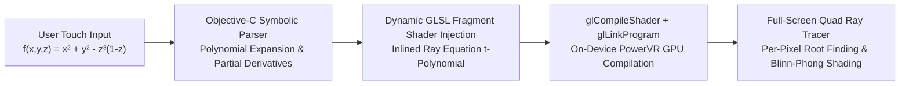

In 2013, for my undergraduate computer engineering thesis project, we set out to bring [**SURFER**](https://imaginary.org/program/surfer)—the famous mathematical exhibition software created for the Oberwolfach Research Institute for Mathematics—onto **iPhone and iPad** as **iSurfer**.

The goal was ambitious: allow anyone to type an arbitrary polynomial equation $f(x, y, z) = 0$ on a touchscreen, rotate the resulting 3D implicit algebraic surface with multi-touch gestures, and see smooth lighting and singularities update in real time.

---

## The 2013 Mobile Hardware Challenge

On desktop machines, traditional implicit surface visualizers either:
1. Run **Marching Cubes** on the CPU to polygonize the zero-isosurface into triangles, or
2. Run a multi-threaded **CPU Ray Tracer** across every pixel.

On a 2013 iPhone (PowerVR SGX mobile GPU and dual-core ARM CPU), both CPU approaches were far too slow for interactive frame rates:
- Polygonizing high-degree algebraic surfaces (where thin spikes and self-intersections like the *Barth Sextic* or *Kummer Quartic* occur) either misses sharp singularities at low grid resolutions or exhausts mobile RAM at high resolutions.
- Tracing hundreds of thousands of rays per frame on an early mobile CPU yielded less than 1–2 FPS.

To hit interactive real-time frame rates on iOS, **we had to move the entire mathematical ray tracer onto the mobile GPU using OpenGL ES 2.0 GLSL fragment shaders**.

---

## Dynamic GLSL Shader Compilation on the Fly

Because OpenGL ES 2.0 has no compute shaders and no dynamic function pointers, we couldn't simply pass an abstract syntax tree (AST) buffer to a generic shader without incurring massive branching overhead inside the inner ray-stepping loop.

Instead, we designed a **Dynamic GLSL Code Generator** in Objective-C:

1. **Symbolic Parsing & Differentiation on CPU**: When the user entered or modified an equation $f(x, y, z) = 0$, our Objective-C parser validated the expression, computed its analytical partial derivatives $\nabla f = \left(\frac{\partial f}{\partial x}, \frac{\partial f}{\partial y}, \frac{\partial f}{\partial z}\right)$ for exact surface normals, and substituted the parametric ray equation $\mathbf{r}(t) = \mathbf{o} + t\mathbf{d}$.
2. **Inlining into GLSL Source**: The resulting polynomial in $t$ and gradient expressions were injected directly as native floating-point math into an OpenGL ES 2.0 fragment shader template.
3. **On-Device GPU Compilation (`glCompileShader`)**: Within milliseconds of the user finishing an equation edit, iOS compiled the specialized GLSL program onto the mobile GPU. Every subsequent camera rotation or zoom frame executed at full native GPU speed across a single full-screen quad—zero polygon meshes, zero CPU-to-GPU geometry uploads, and infinite mathematical smoothness.

---

## Legacy & The 2026 WebGL2 Successor (`SurfZar`)

Building **iSurfer** in 2013 sparked a lifelong fascination with GPU-accelerated mathematical rendering and shader compilers. Over a decade later, in 2026, I revisited this exact domain for the modern web with [**SurfZar — Real-Time 3D Algebraic Surface Studio**](/posts/surfzar_realtime_3d_algebraic_surfaces_webgl), combining closed-form Cardano/Ferrari analytical root solvers, WebGL2 GLSL interval raymarching, dual-sided PBR lighting, and watertight Marching Cubes STL 3D printing directly in the browser.

- [**Watch the original 2013 iSurfer iPhone Demo on YouTube**](https://youtu.be/Y3HUX5ARSs8)
