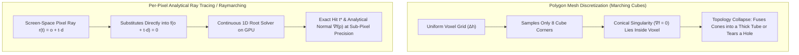

When we began designing **iSurfer**—our undergraduate Computer Engineering thesis at **ITBA** (*Instituto Tecnológico de Buenos Aires*), inspired by the [**IMAGINARY**](https://www.imaginary.org/) open-mathematics platform and the Oberwolfach Research Institute's [**SURFER**](https://www.imaginary.org/program/surfer)—our goal was to render arbitrary real algebraic surfaces interactively on an iPhone and iPad using **OpenGL ES 2.0**.

An implicit real algebraic surface $\mathcal{S} \subset \mathbb{R}^3$ is the zero-level set of a trivariate polynomial $f(x, y, z) \in \mathbb{R}[x, y, z]$ of degree $d$:

$$\mathcal{S} = \left\{ (x, y, z) \in \mathbb{R}^3 \;\middle|\; f(x, y, z) = \sum_{i+j+k \le d} c_{ijk} \, x^i y^j z^k = 0 \right\}$$

Unlike standard 3D game assets (cars, characters, architecture) modeled as explicit triangle meshes in Blender or Maya, algebraic surfaces are defined purely by mathematical equations:

* **Steiner's Roman Surface** ($d = 4$): $x^2 y^2 + y^2 z^2 + z^2 x^2 - 2xyz = 0$
* **Kummer's Quartic** ($d = 4$, 16 double points): $(x^2+y^2+z^2-\mu^2)^2 - \lambda p q r s = 0$
* **Cayley's Nodal Cubic** ($d = 3$, 4 conical nodes): $x^2 + y^2 + z^2 + x^2 z - y^2 z - 1 = 0$
* **The Barth Sextic** ($d = 6$, 65 ordinary double points): $4(\phi^2 x^2 - y^2)(\phi^2 y^2 - z^2)(\phi^2 z^2 - x^2) - (1 + 2\phi)(x^2 + y^2 + z^2 - 1)^2 = 0$

The first architectural question every graphics programmer asks is: **"Why not just run Marching Cubes on the equation $f(x,y,z) = 0$ to generate a triangle mesh, upload a Vertex Buffer Object (VBO) to OpenGL ES, and rasterize it normally?"**

Here is why polygon meshes fail catastrophically for algebraic geometry—both mathematically and computationally—and why we built a **per-pixel GPU ray tracer / raymarcher** instead.

---

## 1. The Singularity Crisis: Why Marching Cubes Breaks Where $\nabla f = \mathbf{0}$

A point $\mathbf{p} \in \mathcal{S}$ on an algebraic surface is **smooth (regular)** if the gradient vector does not vanish:

$$\nabla f(\mathbf{p}) = \left( \frac{\partial f}{\partial x}(\mathbf{p}),\, \frac{\partial f}{\partial y}(\mathbf{p}),\, \frac{\partial f}{\partial z}(\mathbf{p}) \right) \neq (0, 0, 0)$$

By the Implicit Function Theorem, around any smooth point, the surface behaves locally like a flat plane with a well-defined unit normal $\mathbf{n} = \nabla f / \|\nabla f\|$.

However, the entire reason mathematicians study surfaces like the *Barth Sextic*, *Chmutov Octic*, or *Ding-Dong* ($x^2 + y^2 - z^3(1-z) = 0$) is their **singularities**—the points where $f(\mathbf{p}) = 0$ **and** $\nabla f(\mathbf{p}) = \mathbf{0}$ simultaneously:
* **Ordinary Double Points ($A_1$ Conical Nodes)**: Two smooth cones touching tip-to-tip at a single infinitesimal point (65 of them on the Barth Sextic!).
* **Cusps & Pinch Points (Whitney Umbrellas)**: Where a surface sheet folds into a razor-sharp crease or self-intersects along a line.
* **Thin Sheets & Grazing Tangents**: Where $f(x,y,z)$ dips to zero and immediately rises back up without changing sign ($f(x,y,z) \ge 0$ everywhere), or changes sign twice inside a microscopic gap.

### How Voxel Polygonization Fails at Singularities

Algorithms like **Marching Cubes** sample $f(x, y, z)$ on a uniform 3D lattice of cubes with edge length $\Delta h$. For each cube, it inspects the **8 corner signs** ($+$ or $-$) and looks up one of $2^8 = 256$ pre-triangulated topological cases, placing vertices along cube edges by linear interpolation:

$$\mathbf{v}_{\text{edge}} = \mathbf{p}_1 + \frac{-f(\mathbf{p}_1)}{f(\mathbf{p}_2) - f(\mathbf{p}_1)}(\mathbf{p}_2 - \mathbf{p}_1)$$

This assumption breaks down in three fundamental ways on algebraic surfaces:

1. **Sub-Voxel Sign Cancellation**: Near a double point where two cone tips meet, the cross-section radius of the cone shrinks to zero. As soon as the cone radius is smaller than the voxel spacing $\Delta h$, both sides of the sheet pass between two adjacent grid vertices. Marching Cubes sees the **same sign** at both corners, concludes the surface does not exist in that cell, and **tears a jagged hole right where the cones should touch**.
2. **Manifold Assumption Violation**: Marching Cubes is designed to produce a 2-manifold triangle mesh. Algebraic surfaces with self-intersections (like *Steiner's Roman Surface*, where three planes intersect along the $x, y, z$ axes) are **non-manifold**. Marching Cubes forces non-manifold junctions to either separate artificially or fuse into blobby tubes.
3. **Zero-Gradient Normal Collapse**: Even if a vertex lands near a singularity, interpolating vertex normals across a triangle spanning $\nabla f \to \mathbf{0}$ produces wild shading seams and flickering specular highlights.

---

## 2. The $O(N^3)$ Memory & Real-Time Edit Wall on Mobile GPUs

Suppose you try to brute-force Marching Cubes by shrinking the voxel size $\Delta h$ so the singularities look sharper.

In 3D space, halving $\Delta h$ multiplies the number of grid cells to evaluate by **$2^3 = 8\times$** and the number of output triangles by **$2^2 = 4\times$**:

| Grid Resolution | Voxel Evaluations ($N^3$) | Approx. Triangles | Vertex + Normal VBO Size | Time to Re-Mesh on Mobile CPU |
| :---: | :---: | :---: | :---: | :---: |
| **$64^3$** | $262,144$ | $\sim 45\text{K}$ | $\sim 1.1\text{ MB}$ | $\sim 0.4\text{ s}$ (Jagged, missing spikes) |
| **$128^3$** | $2,097,152$ | $\sim 180\text{K}$ | $\sim 4.3\text{ MB}$ | $\sim 3.1\text{ s}$ (Visible faceting) |
| **$256^3$** | $16,777,216$ | $\sim 720\text{K}$ | $\sim 17.3\text{ MB}$ | $\sim 24.8\text{ s}$ (Unusable for live editing) |
| **$512^3$** | $134,217,728$ | $\sim 2.9\text{M}$ | $\sim 69.1\text{ MB}$ | **Out of Memory / Freeze** |

In **iSurfer**, the core user experience is **interactive mathematical exploration**:
* The user edits a formula or drags a parameter slider $a \in [-5, 5]$ to watch a surface morph through a topological transition (for example, watching a smooth cubic surface pinch into Cayley's 4 nodal singularities).
* If every parameter change required re-evaluating $16\text{ million}$ grid points on the CPU, running Marching Cubes, allocating megabytes of vertex buffers, and uploading them over the bus via `glBufferData`, the frame rate would drop to **0.04 FPS**.
* Worse, as soon as the user pinches to zoom closely into a singularity, a fixed-resolution mesh reveals ugly flat triangles—requiring a dynamic octree re-meshing pass that stalls the UI thread.

---

## 3. The GPU Ray-Tracing Paradigm: Resolution-Independent Implicit Precision

Instead of discretizing **3D object space** into millions of triangles on the CPU, per-pixel GPU ray tracing discretizes only **2D screen space** (the pixels currently visible on the display):

1. **Zero Geometry Buffers**: The vertex stage draws only a single bounding volume (a full-screen quad or bounding box/sphere of 2 to 12 triangles). Vertex memory footprint is under **1 KB**, regardless of whether the equation is a simple sphere ($x^2 + y^2 + z^2 - 1 = 0$) or a degree-10 Chmutov surface with hundreds of singularities.
2. **Complexity Scales with Screen Pixels ($O(W \times H)$), Not Volume ($O(N^3)$)**:
   For each pixel $(u, v)$ covered by the bounding sphere, the fragment shader constructs a viewing ray in object space:
   $$\mathbf{r}(t) = \mathbf{o} + t\mathbf{d}, \quad t \in [t_{\text{enter}}, t_{\text{exit}}]$$
   Substituting $\mathbf{r}(t)$ into $f(x, y, z) = 0$ turns the 3D surface intersection into a **1D univariate equation along the ray**:
   $$g(t) = f(o_x + t d_x,\, o_y + t d_y,\, o_z + t d_z) = 0$$
3. **Infinite Zoom Without Re-Meshing**:
   When you pinch-zoom $100\times$ into a microscopic conical singularity of the Barth Sextic, the camera ray origin $\mathbf{o}$ and direction $\mathbf{d}$ simply narrow their field of view. The fragment shader still solves $g(t) = 0$ to floating-point precision for each screen pixel—meaning the singularity remains **razor-sharp at any magnification** with zero extra memory and zero CPU work!
4. **Exact Analytical Normals at Every Pixel**:
   Once the smallest positive root $t^* \in [t_{\text{enter}}, t_{\text{exit}}]$ is found, the exact hit point is $\mathbf{p}^* = \mathbf{o} + t^*\mathbf{d}$, and the fragment shader evaluates the exact symbolic gradient $\nabla f(\mathbf{p}^*)$ right at that pixel—eliminating Mach bands and specular wobble completely.

---

## Up Next in Part 2

Knowing *why* we must evaluate $f(\mathbf{o} + t\mathbf{d}) = 0$ per pixel inside an OpenGL ES 2.0 fragment shader raises an immediate systems engineering challenge: **GLSL shaders are compiled programs on the GPU, not interpreted strings**. When a user types a brand-new algebraic equation on the iPhone keyboard, how do we parse it, expand its exponents and derivatives, translate it into optimized GLSL code, and compile it onto the mobile GPU on the fly in milliseconds?

Read [**iSurfer Part 2: From Touch Input to GPU Silicon — The Equation Parser & On-the-Fly GLSL Shader Compiler**](/posts/isurfer-part-2-equation-parser-ast-and-on-the-fly-glsl-compiler).
