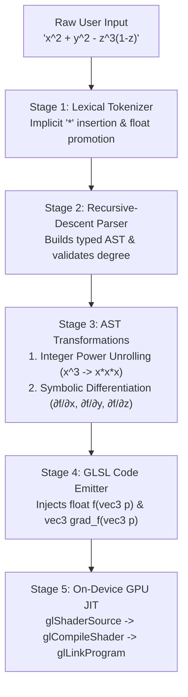

In [**Part 1 of the iSurfer series**](/posts/isurfer-part-1-why-raytracing-beats-triangle-meshes-for-algebraic-surfaces), we saw why rendering implicit algebraic surfaces $f(x, y, z) = 0$ with sharp singularities requires casting continuous per-pixel rays inside an OpenGL ES 2.0 fragment shader rather than generating polygon meshes with Marching Cubes.

That architectural choice immediately confronts a hard hardware constraint: **OpenGL ES 2.0 fragment shaders run compiled machine code on the GPU, but the equation $f(x, y, z) = 0$ is typed by the user at runtime.**

How do you let a user type an arbitrary equation like:

```text
4(x^2 + y^2 - z^2) + 16xyz - 1
```

and execute it tens of millions of times per second on a mobile GPU?

---

## 1. Why a Shader Bytecode Interpreter Fails on Mobile GPUs

When engineers first encounter the problem of evaluating user-defined formulas on a GPU, their first instinct is often to write **one static fragment shader** containing a stack-based virtual machine (RPN / Postfix bytecode interpreter):
1. Parse the user's string on the CPU into an array of opcodes (`OP_PUSH_X`, `OP_CONST 2`, `OP_POW`, `OP_ADD`, ...).
2. Upload the opcode array as a `uniform int uProgram[64]` buffer.
3. Run a `for` loop with a `switch` / `if-else` dispatch ladder inside `float evaluate(vec3 p)` on the GPU.

We benchmarked this approach early on, and **it is roughly $25\times$ to $40\times$ slower than native GLSL**—dropping frame rates from 30+ FPS to under 1 FPS. Why?

* **Inner-Loop Amplification**: For a single pixel, the raymarcher + root refiner evaluates $f(\mathbf{p})$ between **24 and 64 times** (stepping along the ray to isolate a sign change, then running Bisection/Newton iterations, then evaluating $\nabla f(\mathbf{p})$ for lighting). If your RPN interpreter loop takes 30 instructions per evaluation, a single pixel executes ~2,000 dynamic loop iterations and branches!
* **SIMD Tile Divergence & Register Spilling**: Mobile GPUs (like the PowerVR SGX series in early iPhones) execute fragments in lockstep SIMD warps across tiles. Maintaining a mutable evaluation `float stack[16]` array with dynamic indexing (`stack[sp++]`) prevents the shader compiler from keeping variables in hardware registers, forcing local memory spills and destroying ALU occupancy.
* **Zero Constant Folding or Instruction Scheduling**: A bytecode interpreter cannot fuse multiply-adds (`FFMA`) or hoist ray-invariant terms out of the loop.

### The Breakthrough: Using `glCompileShader` as a Live JIT Compiler

OpenGL ES 2.0 ships with a full optimizing GLSL compiler built directly into the iOS graphics driver (`glShaderSource` $\to$ `glCompileShader` $\to$ `glLinkProgram`).
* **Equation edits happen at human speed** (once every few seconds when the user finishes typing a formula).
* **Camera rotations, pinch-zooms, and parameter slider animations happen at 60 Hz** (every 16.6 ms).

By translating the user's equation into specialized, branch-free GLSL source code on the CPU and invoking `glCompileShader` on the fly whenever the equation string changes, the iOS driver compiles our exact polynomial down to native PowerVR hardware instructions (`FMUL`, `FADD`, `FFMA`) in **~8–15 milliseconds**—and every frame thereafter runs at full hardware speed!



---

## 2. Stage 1: Lexical Analysis & Human Math Normalization

Mathematicians and students do not write formulas in strict C/GLSL syntax. If someone types `2x^2 + 3xy - z(1 - z)` into a raw GLSL shader, compilation fails for three separate reasons:
1. **Implicit Multiplication**: `2x`, `3xy`, and `z(1 - z)` omit the `*` operator.
2. **Caret Exponentiation**: In C and GLSL, `^` is the bitwise XOR operator, not exponentiation!
3. **Strict Integer-Float Typing in GLSL ES 1.00**: In GLSL ES (`#version 100`), writing `float val = 2 * p.x + 1;` is a **fatal compile error** (`'*' : wrong operand types - no operation '*' exists that takes a left-hand operand of type 'const int' and a right operand of type 'highp float'`). Every numeric literal *must* be emitted with a decimal point (`2.0`, `1.0`).

Our tokenizer scans the input stream into typed tokens (`number`, `variable`, `operator`, `function`, `lparen`, `rparen`) and applies two normalization passes:
* **Multi-Variable Splitting & Implicit Multiplication Insertion**: Whenever a `number`, `variable`, or `rparen` token is immediately followed by a `variable`, `function`, or `lparen` token without an intervening operator, the lexer synthesizes an explicit `{ type: 'operator', value: '*' }` token:
  * `16xyz` $\longrightarrow$ `16.0 * x * y * z`
  * `(x^2 + y^2)(y^2 + z^2)` $\longrightarrow$ `(x^2 + y^2) * (y^2 + z^2)`
* **IEEE Float Literal Formatting**: Every integer constant `N` is formatted as `N.0` in the emitted GLSL (except when inspected as an integer exponent by the AST power expander).

---

## 3. Stage 2: Recursive-Descent AST Construction & Degree Classification

From the normalized token stream, a **Recursive-Descent Parser** constructs a typed Abstract Syntax Tree (`ASTNode`) respecting standard mathematical operator precedence and associativity:

1. **`parseExpression()`**: Left-associative binary addition and subtraction (`+`, `-`).
2. **`parseTerm()`**: Left-associative binary multiplication and division (`*`, `/`).
3. **`parsePower()`**: **Right-associative** exponentiation (`^`), so `a ^ b ^ c` parses as `a ^ (b ^ c)`.
4. **`parseUnary()`**: Prefix unary operators (`-x`, `+x`).
5. **`parsePrimary()`**: Parenthesized sub-expressions `(...)`, function calls (`sin`, `cos`, `sqrt`, `pow`), variables (`x, y, z`, parameters `a, b, c, d`, time `t`), and numeric literals.

```typescript
export type ASTNodeType = 'number' | 'variable' | 'binary' | 'unary' | 'function';

export interface ASTNode {
  type: ASTNodeType;
  value?: number | string;
  operator?: string;
  left?: ASTNode;
  right?: ASTNode;
  argument?: ASTNode;
  args?: ASTNode[];
}
```

Once the AST is built, we traverse it with `calculateDegree(ast)` before generating any shader code:
* Variables `X`, `Y`, `Z` have degree $1$; constants and uniform parameters (`A, B, C, D`) have degree $0$.
* Addition/subtraction takes $\max(\deg(L), \deg(R))$.
* Multiplication takes $\deg(L) + \deg(R)$.
* Exponentiation `base ^ exp` with a non-negative integer constant `exp` takes $\deg(\text{base}) \times \text{exp}$.

Knowing the total degree $d$ (e.g., $d=2$ quadric, $d=3$ cubic, $d=4$ quartic, $d=6$ sextic) allows the shader compiler to select the optimal root-finding strategy and step count automatically!

---

## 4. Stage 3: Why `pow(x, n)` Breaks Negative Coordinates—and How AST Power Unrolling Fixes It

One of the most subtle traps in GPU mathematical rendering involves translating `x^2` or `(x + y)^3` into GLSL.

If you naively translate `A ^ B` into GLSL's built-in `pow(A, B)`:
1. **The Negative-Base `NaN` Bug**: According to the OpenGL ES Shading Language specification (Section 8.2, *Exponential Functions*), **`pow(x, y)` results are undefined if $x < 0$**! Why? Because GPUs implement `pow(x, y)` in hardware using the Special Function Unit (SFU) identity:
   $$\text{pow}(x, y) = 2^{y \cdot \log_2(x)}$$
   Whenever a pixel ray passes through negative coordinates ($x < 0$, which is **7 out of the 8 octants of $\mathbb{R}^3$**!), $\log_2(x)$ evaluates to `NaN`. As a result, translating `x^2 + y^2 + z^2 - 1` into `pow(p.x, 2.0) + pow(p.y, 2.0) + pow(p.z, 2.0) - 1.0` causes **7/8ths of the sphere to vanish into NaN black pixels** on mobile GPUs!
2. **SFU Throughput Bottleneck**: Even if you wrap the base in `abs(x)` for even powers, hardware transcendental instructions (`LG2` + `MUL` + `EX2`) have $4\times$ to $8\times$ lower throughput than standard floating-point multipliers (`FMUL`).

### Balanced Binary Multiplication Tree Unrolling

To guarantee both mathematical correctness across all 8 octants of $\mathbb{R}^3$ and maximum ALU throughput, our AST code generator intercepts every `^` node with an integer exponent $n \in \mathbb{Z}$ and expands it into a **balanced tree of pure multiplications**:

```typescript
function expandIntegerPower(baseStr: string, exp: number): string {
  if (exp === 0) return '1.0';
  if (exp === 1) return baseStr;
  if (exp === 2) return `((${baseStr}) * (${baseStr}))`;
  if (exp === 3) return `((${baseStr}) * (${baseStr}) * (${baseStr}))`;
  if (exp === 4) {
    // Balanced tree: (b*b) * (b*b) -> only 2 dependent multiply depths!
    return `(((${baseStr}) * (${baseStr})) * ((${baseStr}) * (${baseStr})))`;
  }
  if (exp === 5) {
    return `((((${baseStr}) * (${baseStr})) * ((${baseStr}) * (${baseStr}))) * (${baseStr}))`;
  }
  if (exp === 6) {
    return `(((${baseStr}) * (${baseStr})) * ((${baseStr}) * (${baseStr})) * ((${baseStr}) * (${baseStr})))`;
  }
  if (exp < 0 && exp >= -6) {
    return `(1.0 / ${expandIntegerPower(baseStr, -exp)})`;
  }
  return `safe_pow(${baseStr}, ${formatGlslFloat(exp)})`;
}
```

And for non-integer or variable exponents (such as $x^{2/3}$), we emit a sign-preserving `safe_pow(base, exp)` helper in the shader preamble that handles negative bases cleanly without producing `NaN`.

---

## 5. Stage 4: Symbolic Partial Differentiation on the AST

To shade the surface with Blinn-Phong or PBR lighting—and to run Newton-Raphson root refinement along the ray—we need the surface gradient $\nabla f(x, y, z) = \left(\frac{\partial f}{\partial x}, \frac{\partial f}{\partial y}, \frac{\partial f}{\partial z}\right)$.

Because the equation is already represented as an in-memory `ASTNode` tree, we can differentiate the AST **symbolically** with respect to any variable $v \in \{X, Y, Z\}$ in a single recursive pass (`differentiateAST(node, v)`):

* **Constant / Other Variable Rule**: $\frac{\partial c}{\partial x} = 0$, $\frac{\partial y}{\partial x} = 0$, $\frac{\partial x}{\partial x} = 1$.
* **Sum & Difference Rule**: $\frac{\partial (u \pm w)}{\partial x} = \frac{\partial u}{\partial x} \pm \frac{\partial w}{\partial x}$.
* **Product Rule**: $\frac{\partial (u \cdot w)}{\partial x} = \frac{\partial u}{\partial x} \cdot w + u \cdot \frac{\partial w}{\partial x}$.
* **Power & Chain Rule**: $\frac{\partial (u^n)}{\partial x} = n \cdot u^{n-1} \cdot \frac{\partial u}{\partial x}$.

Running a quick algebraic simplification pass (pruning `0 * expr` $\to$ `0`, `1 * expr` $\to$ `expr`, and `expr + 0` $\to$ `expr`) produces a compact, exact analytical gradient function `vec3 grad_f(vec3 p)` right inside the generated shader! (For complex transcendental expressions in **SurfZar**, we also pair this with a symmetric 4-point tetrahedral finite-difference stencil to keep instruction counts bounded.)

---

## 6. Stage 5: Real-Time On-Device Shader Compilation & Hot-Swapping

Once the AST emitter produces the GLSL strings for `f(vec3 p)` and `grad_f(vec3 p)`, it injects them into the master fragment shader template (`#define USER_FUNCTION ...`) and triggers an immediate GPU recompile on the active `EAGLContext` (on iOS) or `WebGL2RenderingContext` (in SurfZar):

```c
// Objective-C / OpenGL ES 2.0 on-the-fly compilation pipeline
GLuint fragShader = glCreateShader(GL_FRAGMENT_SHADER);
const GLchar *sourcePtr = (const GLchar *)[generatedGLSLSource UTF8String];
glShaderSource(fragShader, 1, &sourcePtr, NULL);
glCompileShader(fragShader);

GLint compiled = GL_FALSE;
glGetShaderiv(fragShader, GL_COMPILE_STATUS, &compiled);
if (compiled == GL_TRUE) {
    GLuint newProgram = glCreateProgram();
    glAttachShader(newProgram, cachedVertexShader);
    glAttachShader(newProgram, fragShader);
    glLinkProgram(newProgram);
    
    // Atomic hot-swap: keep previous valid shader running if user is mid-typing!
    glDeleteProgram(activeProgram);
    activeProgram = newProgram;
    [self rebindUniformLocations:activeProgram];
}
glDeleteShader(fragShader);
```

Notice the **Atomic Hot-Swap pattern**: while a user is mid-typing an incomplete expression like `x^2 + y^2 -`, the parser or compiler detects the incomplete syntax and **keeps the previous compiled `GLuint activeProgram` bound**, displaying a non-intrusive syntax indicator in the HUD. The instant the user types the final character `1`, the new shader compiles in ~10 ms and swaps in on the very next `CADisplayLink` / `requestAnimationFrame` vsync tick!

---

## Up Next in Part 3

Now that our user's equation is compiled into native GPU machine instructions inside `float f(vec3 p)`, how does the fragment shader actually intersect each pixel ray with the surface, isolate the closest root among up to 6+ intersections, refine it without diverging at singularities, and shade both sides of the manifold?

Read [**iSurfer Part 3: Inside the OpenGL ES 2.0 Fragment Shader Ray Tracer — Root Isolation, Safeguarded Newton-Bisection & Two-Sided Shading**](/posts/isurfer-gpu-raytracing-algebraic-surfaces-ios).
