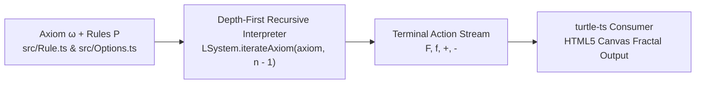

In my previous post on [**Deploying My First TypeScript Library**](/posts/deploying-your-first-typescript-library), I walked through packaging and publishing `turtle-ts` to the npm registry so I would have a clean 2D Turtle Graphics foundation in TypeScript.

Two weeks later, I completed the second half of that experiment: [**`lsystemts` (`daniazar/lsystemts`)**](https://github.com/daniazar/lsystemts)—a Lindenmayer System (L-System) grammar evaluator that consumes `turtle-ts` to generate **self-similar fractals** and **space-filling curves** in the browser.

---

## What is an L-System Grammar?

Introduced in 1968 by biologist Aristid Lindenmayer to model cellular and plant growth, a deterministic context-free **L-System** is a formal grammar $G = (V, \omega, P)$ defined by:

1. **Alphabet ($V$)**: Terminal drawing symbols (`F` = draw forward, `f` = move forward with pen up, `+` = turn right by $\theta$, `-` = turn left by $\theta$) and non-terminal variables (`X`, `Y`).
2. **Axiom ($\omega$)**: The initial starting string at iteration $0$.
3. **Production Rules ($P$)**: Rewrite rules (`Rule.ts`) that map each symbol to a replacement string at every recursion step.

---

## Why Depth-First Recursion Beats String Expansion

A naive L-System implementation rewrites the entire string in memory at each iteration ($S_0 \rightarrow S_1 \rightarrow \dots \rightarrow S_n$) before drawing. However, because production rules expand exponentially—for example, the Sierpinski rule `X → XF+XF-XF-XF+XF` multiplies string length by $5\times$ per step—allocating the full expanded string at higher iteration depths quickly wastes megabytes of heap memory.

In [**`lsystemts`**](https://github.com/daniazar/lsystemts), `src/LSystem.ts` avoids materializing intermediate strings altogether by evaluating the production rules **recursively on the fly** via depth-first traversal (`iterateAxiom`):

```typescript
import { Turtle } from "turtle-ts";
import { Options } from "./Options";
import { Rule } from "./Rule";

export class LSystem {
  private _axiom: string;
  private _rules: Record<string, Rule> = {};
  protected _options: Options;
  protected _turtle: Turtle;

  public constructor(axiom: string, rules: Rule[], options: Options, turtle: Turtle) {
    this._axiom = axiom;
    this._options = options;
    for (const rule of rules) {
      this._rules[rule.letter] = rule;
    }
    this._turtle = turtle;
  }

  public start() {
    this._turtle.setColor(this._options.color);
    this.iterateAxiom(this._axiom, this._options.iterations);
  }

  public iterateAxiom(axiom: string, iterations: number) {
    if (iterations === 0) return;
    for (const c of axiom) {
      switch (c) {
        case '+':
          this._turtle.right(this._options.angle);
          break;
        case '-':
          this._turtle.left(this._options.angle);
          break;
        case 'F':
          this._turtle.forward(this._options.length);
          break;
        case 'f':
          this._turtle.penUp();
          this._turtle.forward(this._options.length);
          this._turtle.penDown();
          break;
        default: {
          const rule = this._rules[c.toUpperCase()];
          if (rule) {
            this.iterateAxiom(rule.axiom, iterations - 1);
          }
        }
      }
    }
  }
}
```



Because `iterateAxiom` only holds the current call-stack frames (bounded by `iterations`, typically $3 \le n \le 8$), memory usage stays $O(n)$ regardless of how many thousands of line segments are drawn.

---

## Built-In Fractal Presets (`src/Examples.ts`)

To make testing and visual experimentation immediate, `lsystemts` includes a static `Examples` catalog (`src/Examples.ts`) defining classic fractals and space-filling curves:

| Preset Method | Axiom ($\omega$) | Production Rules ($P$) | Turn Angle ($\theta$) | Default Depth |
| :--- | :--- | :--- | :--- | :--- |
| `Examples.SierpinskiTriangle()` | `X+X+X` | `X → XF+XF-XF-XF+XF` | $120^\circ$ | $3$ |
| `Examples.KochSnowflake()` | `X++X++X` | `X → XF-XF++XF-XF` | $60^\circ$ | $4$ |
| `Examples.HilbertCurve()` | `X` | `X → -YF+XFX+FY-`, `Y → +XF-YFY-FX+` | $90^\circ$ | $4$ |

Check out the full source code on GitHub at [**github.com/daniazar/lsystemts**](https://github.com/daniazar/lsystemts).
