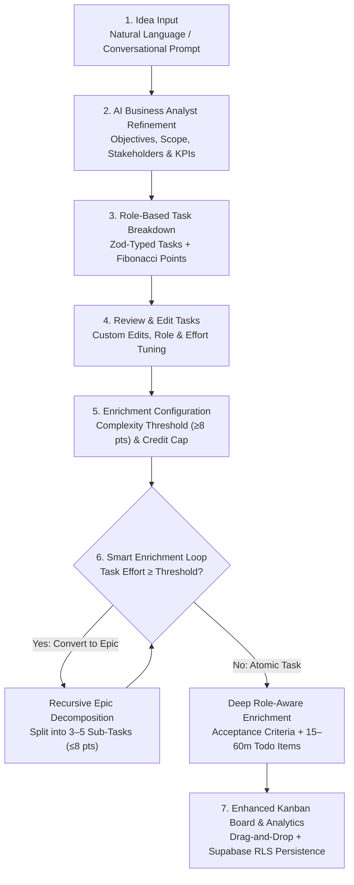

One of the most persistent bottlenecks in software engineering happens before a single line of application code is written: **translating a high-level product idea into a structured, accurately estimated, cross-functional engineering backlog**.

For my **MBA Master's Thesis** (completed in July 2025 under the [**MoltenMinds**](https://moltenminds.com/) umbrella), I conducted empirical market research with software engineers, project managers, tech leads, and business analysts, and built [**Molten AI Agent (`molten-ai-agent`)**](https://github.com/daniazar/molten-ai-agent)—an AI-powered task automation web platform that takes raw project concepts and "melts" them down into structured specifications, role-assigned tasks, recursively decomposed Epics, and prioritized micro-checklists on an interactive Kanban board.


---

## 1. Empirical Market Research: Quantifying the Planning Bottleneck

Before designing the product architecture, Chapter 3 of the thesis surveyed **38 industry professionals** (>60% with 6+ years of experience in technology projects; ~50% software engineers/developers and >35% PMs, Tech Leads, and Business Analysts):

- **Agile Dominance (~90%)**: Nearly 90% of surveyed teams operate under Scrum, Kanban, or hybrid Agile methodologies, with **Jira** used by ~2 out of every 3 respondents.
- **Low Satisfaction with Manual Task Breakdown (~60%)**: Nearly 60% of respondents rated their satisfaction with current task planning and breakdown processes as neutral-to-very-low (scores 1–3 out of 5), with only 10.8% "very satisfied".
- **High Time Cost (46% spend >25% of planning time)**: Over 70% of respondents dedicate more than 10% of their total planning time strictly to initial epic and task breakdown—and **46% spend more than 25% of their planning time** on this manual translation step.
- **Core Pain Points ("Vocabulary of Pain")**: The top three reported challenges were **time consumption**, **lack of clarity in requirements**, and **human estimation/omission errors**.
- **Strong Product-Market Validation (>75%)**: More than 75% of surveyed professionals rated an AI-assisted task decomposition and enrichment tool as *"Valuable"* or *"Extremely Valuable"* (scores 4 and 5).

---

## 2. Architectural Overview: The 7-Stage Guided & Autonomous Pipeline

Rather than treating backlog generation as a single one-shot LLM prompt—which produces shallow checklists and erodes user trust—**Molten AI Agent** structures the workflow into **seven explicit stages** with a live header toggle between **Manual Control** (review and approve each step) and **Autonomous Mode**:




### Multi-Project Persistence Dashboard
Authenticated users land on the **Project Control Dashboard** backed by **Supabase PostgreSQL** with Row-Level Security (RLS), allowing teams to create new initiatives or resume existing projects at their exact workflow stage:


---

## 3. Stages 1 & 2: Idea Intake & AI Business Analyst Refinement

In **Stage 1 (`Idea Input`)**, the user describes their project in natural language—for example, *"Create a customer feedback management system"*:


In **Stage 2 (`AI Refinement` — `/api/refine-idea`)**, the agent acts as a Senior Business Analyst, transforming the raw sentence into a structured specification covering:
1. **Project Title** (*Customer Feedback Management System — CFMS*)
2. **Main Objective and Business Value**
3. **Key Features & Components** (*Multi-Channel Feedback Collection, Centralized Repository, Real-Time Analytics Dashboard, Automated Response System, Reporting & Insights*)
4. **Target Users / Stakeholders** (*Customers, Support Team, Product Development, Marketing, Management*)
5. **Measurable Success Criteria & Expected Outcomes** (*NPS lift, $\ge 70\%$ response rate, $10\%$ churn reduction*)


---

## 4. Stages 3 & 4: Schema-Enforced Role Breakdown & Interactive Task Editor

Once the refined brief is approved, **Stage 3 (`Task Breakdown` — `/api/generate-tasks`)** uses the Vercel AI SDK (`generateObject`) with strict **Zod schemas** to synthesize cross-functional tasks across four specialized team roles (**`developer`**, **`designer`**, **`qa`**, and **`product-manager`**), complete with **Fibonacci effort estimates** (`1, 2, 3, 5, 8, 13, 21`), domain tags, and explicit inter-task dependencies (`Dependencies: developer-002`, etc.):

```typescript
const taskSchema = z.object({
  tasks: z.array(
    z.object({
      id: z.string(),
      title: z.string(),
      summary: z.string(),
      effort: z.number(), // Fibonacci scale: 1, 2, 3, 5, 8, 13, 21
      role: z.enum(["developer", "designer", "qa", "product-manager"]),
      tags: z.array(z.string()),
      dependencies: z.array(z.string()),
      status: z.enum(["todo", "in-progress", "review", "done"]).default("todo"),
    }),
  ),
})
```


Directly addressing the market survey's top concern around **AI accuracy and human control**, **Stage 4 (`Edit Tasks`)** lets users review, customize, add, or prune any generated task before committing API credits to deep enrichment.

---

## 5. Stages 5 & 6: Credit-Gated Governance & Recursive Epic Decomposition

Because recursive LLM calls can multiply token costs, **Stage 5 (`Enrichment Configuration`)** introduces explicit **Credit & Complexity Governance**:

- **Enrichment Presets**: Choose between *Skip Enrichment* (`0 credits`), *Light Enrichment* (`~6 credits`, basic decomposition only), or *Full Enrichment* (`~18 credits`, complete decomposition + micro-todo generation).
- **Fibonacci Complexity Threshold**: Tasks with effort $\ge$ the selected Fibonacci threshold (default: **8 points**) are flagged as too complex for a single sprint and automatically decomposed into an **Epic** with 3–5 smaller sub-tasks.
- **Maximum Iterations Cap**: Bounds the recursion depth (e.g., `3 iterations`) to prevent infinite decomposition loops while displaying live estimated credits, cost, and processing time.


During **Stage 6 (`Task Enrichment`)**, `/api/decompose-to-epic` and `/api/enrich-task-advanced` iterate over the backlog:
1. Every task $\ge 8$ points is promoted to an **Epic** and split into 3–5 independently deliverable sub-tasks ($\le 8$ points).
2. Each atomic task is enriched with role-specific acceptance criteria, Definition of Done, and a prioritized **5–8 item todo checklist** where each action item is scoped to **15–60 minutes**.

---

## 6. Stage 7: Enhanced Kanban Board & Real-Time Project Analytics

Finally, the enriched backlog is rendered on the **Enhanced Project Kanban Board** (`To Do`, `In Progress`, `Review`, `Done`) with drag-and-drop status transitions, export/share actions, and a live **Project Statistics & Real-Time Analytics** dashboard tracking total tasks, story points, active epics, estimated working days, and role/priority distributions:


---

## Links & Resources

- **GitHub Repository**: [**github.com/daniazar/molten-ai-agent**](https://github.com/daniazar/molten-ai-agent)
- **Consultancy**: [**MoltenMinds (moltenminds.com)**](https://moltenminds.com/)
