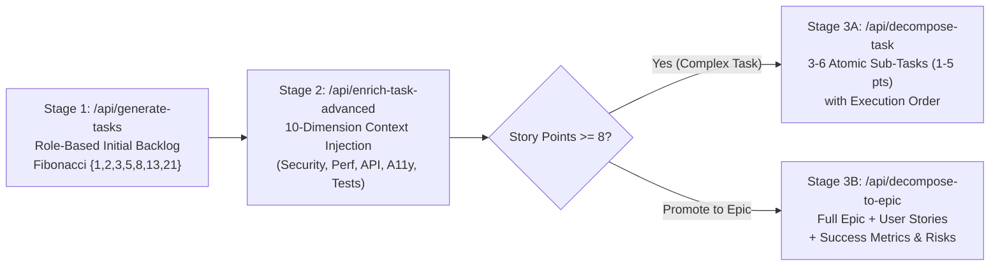

In my [**Master's Thesis overview of Molten AI Agent**](/posts/molten-ai-agent-master-thesis), I shared the empirical results and product workflow of our 7-stage autonomous Business Analyst & Project Management system.

In this follow-up technical post, I want to look directly at the **TypeScript API routes and Zod schema pipelines** (`app/api/generate-tasks/route.ts`, `app/api/enrich-task-advanced/route.ts`, `app/api/decompose-task/route.ts`, and `app/api/decompose-to-epic/route.ts`) that solved the hardest engineering problem in the thesis: **preventing "Single-Prompt Scope Collapse" when LLMs estimate and decompose software architectures.**


---

## 1. The Failure Mode of Single-Shot LLM Backlog Generation

When you ask a frontier LLM in a single prompt to *"Generate a complete Agile backlog for a multi-tenant SaaS application"*, it consistently exhibits three failure modes:
1. **Granularity Collapse**: It mixes trivial 1-hour tasks (*"Create login button"*) alongside massive multi-week epics (*"Build payment & billing engine"*) at the same flat hierarchy level.
2. **Unbounded Story Point Inflation**: Without strict schema constraints, the model invents non-Fibonacci numbers (`4`, `6`, `10`, `15` points) or assigns `5 points` to a task that actually hides four distinct backend, frontend, database, and security sub-projects.
3. **Context Starvation in Acceptance Criteria**: Because output token budgets are finite, generating 20 tasks in one call forces the model to write generic 1-line descriptions instead of concrete technical specifications, data models, and edge cases.

To eliminate these failure modes, we split backlog synthesis into **four orthogonal, Zod-enforced API stages**.



---

## 2. Enforcing Fibonacci Invariants with Strict Zod Schemas (`/api/generate-tasks`)

In `app/api/generate-tasks/route.ts`, we use the Vercel AI SDK's `generateObject` with a strict `TaskSchema` that constrains both the role taxonomy and the **Fibonacci story point scale**:

```typescript
const TaskSchema = z.object({
  title: z.string().describe("Clear, concise task title"),
  description: z.string().describe("Detailed description of what needs to be done"),
  category: z.enum([
    "Frontend",
    "Backend",
    "Database",
    "Design",
    "Testing",
    "DevOps",
    "Research",
    "Integration",
  ]),
  priority: z.enum(["High", "Medium", "Low"]),
  storyPoints: z
    .number()
    .int()
    .refine((val) => [1, 2, 3, 5, 8, 13, 21].includes(val), {
      message: "Story points must follow the Fibonacci sequence (1, 2, 3, 5, 8, 13, 21)",
    }),
  acceptanceCriteria: z
    .array(z.string())
    .min(2)
    .max(5)
    .describe("Testable acceptance criteria"),
  dependencies: z.array(z.string()).describe("Other task titles this depends on"),
  risks: z.array(z.string()).describe("Technical or delivery risks"),
});
```

Crucially, the system prompt explicitly calibrates the model's estimation scale so complex architectural modules are **intentionally assigned `8`, `13`, or `21` points** rather than being artificially compressed into a `5`:
* **`1–2 pts`**: Simple CRUD endpoint or UI component with zero external dependencies.
* **`3–5 pts`**: Multi-component feature completable within a single sprint by one engineer.
* **`8–21 pts`**: Cross-cutting architectural subsystem that **must** be routed to the recursive decomposition engine.

---

## 3. Configurable 10-Dimension Task Enrichment (`/api/enrich-task-advanced`)

Before decomposing or executing a task, the engineer or product manager configures the **Enrichment Matrix** (`components/enrichment-settings.tsx` and `app/api/enrich-task-advanced/route.ts`).

Instead of bloating every ticket with boilerplate, `enrich-task-advanced` dynamically constructs its prompt and output schema from **10 toggleable engineering dimensions** plus custom company coding standards:

1. **Detailed Implementation Steps** (`includeImplementationSteps`)
2. **Gherkin / Testable Acceptance Criteria** (`includeAcceptanceCriteria`)
3. **Architecture & Data Flow Context** (`includeTechnicalDetails`)
4. **Security & OWASP Threat Vector Analysis** (`includeSecurityConsiderations`)
5. **Performance & Latency Budgets** (`includePerformanceMetrics`)
6. **Unit, Integration & E2E Testing Strategy** (`includeTestingStrategy`)
7. **Error Handling & Retry Semantics** (`includeErrorHandling`)
8. **API Contract & Payload Definitions** (`includeApiSpecs`)
9. **WCAG Accessibility Requirements** (`includeAccessibility`)
10. **Documentation & Runbook Deliverables** (`includeDocumentation`)

---

## 4. The $\ge 8$ Story Point Threshold: Sub-Task vs. Epic Decomposition

Once the backlog is estimated and enriched, any task with `storyPoints >= 8` is flagged in the UI (`components/task-breakdown.tsx`) with two distinct decomposition paths:


### Path A: Atomic Sub-Task Decomposition (`/api/decompose-task`)
When a single complex task (e.g., *`13 pts` — Implement Real-Time Notification System*) needs to be broken into sprint-ready engineering work items, `/api/decompose-task` enforces a strict **complexity reduction invariant**:
* Every generated sub-task **must have `storyPoints` $\in \{1, 2, 3, 5\}$** (never $\ge 8$, preventing infinite recursion).
* Each sub-task includes an explicit `order` index ($1 \dots K$), `technicalApproach`, and `estimatedHours` so the team knows the exact critical-path sequence.

### Path B: Epic Promotion (`/api/decompose-to-epic`)
When a high-point item represents an entire product pillar rather than a single feature, `/api/decompose-to-epic` promotes it into a first-class **Agile Epic** (`EpicDecompositionSchema`) containing:
* **Business Value Statement** & **Measurable Success Metrics (KPIs)**
* **4 to 8 User Stories** formatted as *"As a [persona], I want [capability] so that [benefit]"*
* **Cross-Story Dependency Graph** and **Mitigation Plan**, which then syncs directly into the persistent multi-column **Kanban Board** (`components/kanban-board.tsx`).
