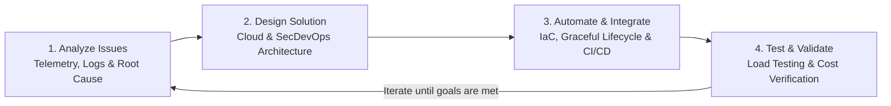

Over the last couple of years, working across large-scale backend architectures, distributed cloud deployments, and enterprise security infrastructure, a recurring pattern kept surfacing: companies rarely struggle with writing standard CRUD logic—they struggle where **software architecture meets cloud infrastructure, security, and scale**.

When a multi-region system starts dropping messages silently during scale-in events, or when TLS inspection appliances bottleneck throughput across hybrid cloud networks, having separate "developers", "cloud ops", and "security auditors" working in silos slows root-cause analysis to a crawl.

That is why we decided to join forces and launch [**MoltenMinds**](https://moltenminds.com/)—a dedicated engineering consultancy built around a simple premise: **We are IT Problem Solvers.**

---

## Who We Are

We built [**MoltenMinds**](https://moltenminds.com/) by combining three complementary engineering backgrounds into a single tight-knit team:

- **Daniel Azar** — *Software Design Engineer*: Focused on distributed backend architectures (C# / .NET, Java, Node.js, Python), cloud auto-scaling, high-throughput messaging queues, and full-stack application engineering.
- **Federico Meiners** — *CyberSecurity Architect*: Focused on enterprise network security, SecDevOps pipelines, HTTPS/SSL inspection, and cloud security posture across hybrid environments.
- **Santiago Arroyo** — *Software Engineer*: Focused on systems integration, cloud-native deployments, automation tooling, and resilient backend services.

Whether a client needs help untangling a legacy deployment, designing a multi-region cloud architecture from scratch, or hardening their infrastructure with real **SecDevOps** practices, our goal is to jump into the hardest part of the stack and engineer a clean, measurable fix.

---

## Our Three Core Pillars

At [**MoltenMinds**](https://moltenminds.com/), our work centers on three intersecting pillars:

### 1. Cloud Architecture & Cost-Aware Scaling (Azure, AWS & Google Cloud)
Moving to the cloud is easy; running a multi-region cloud deployment without burning unnecessary budget or losing data under burst load is the real challenge. We design and audit workloads across **Microsoft Azure**, **AWS**, and **Google Cloud**—ranging from custom queue-depth auto-scaling engines on Azure App Service and WebJobs to multi-tier caching strategies with Redis and Blob Storage.

### 2. Cybersecurity & Real SecDevOps
Security shouldn't be a checklist bolted on at the end of a release cycle. We focus on pragmatic **SecDevOps**: embedding security controls, automated certificate lifecycle management, deep HTTPS/SSL inspection (such as Check Point gateway inspection pipelines), and least-privilege cloud IAM directly into CI/CD and infrastructure code.

### 3. Deep Systems Integration & Automation
Modern architectures rarely live in a single vendor's ecosystem. We build the glue and automation layers that let disparate services, identity providers, message brokers, and monitoring stacks operate as one cohesive platform.

---

## How We Work: Iterative Engineering

Every tough infrastructure or architecture problem looks murky at first—whether it is intermittent storage throttling or broken trace logs across 20 cloud instances. Instead of guessing or throwing larger VM SKUs at a bottleneck, we follow a strict iterative engineering loop:

1. **Analyze the Issues**: We correlate telemetry across application logs, cloud platform diagnostics, cache downtime windows, and network boundaries to isolate the exact root cause rather than treating symptoms.
2. **Design a Solution**: We architect a targeted fix—such as semaphore-driven graceful shutdown hooks for scale-in events, or partition-aware naming conventions and exponential backoff policies for cloud storage.
3. **Automate & Integrate**: We codify the solution into repeatable deployments so manual operational toil disappears.
4. **Test & Repeat**: We verify the fix under real production load and iterate until both reliability and cost-efficiency targets are reached.

---

## Sharing Our Field Notes

As part of launching [**MoltenMinds**](https://moltenminds.com/), we also want to document and share real-world post-mortems and architectural lessons from our client engagements (anonymized, of course) so other engineering teams can avoid the same pitfalls:

- [**The Hurdles of Auto Scaling an Application to Reduce Costs**](/posts/auto-scale-problems) — How we designed a custom queue-depth auto-scaler in C# on Azure App Service and solved silent data corruption during instance scale-in using semaphore-based graceful shutdowns.
- [**Issues When Using Configuration Files in Scaling Environments**](/posts/auto-scale-blob-storage) — Tracking down a 600-process stampede during Redis failovers that hit Azure Blob Storage's 500 RPS throttle limit, and fixing it with exponential backoff and storage partition naming conventions.

If you are facing a complex cloud scaling bottleneck, a tricky SecDevOps integration, or a distributed systems mystery, check out [**moltenminds.com**](https://moltenminds.com/) or reach out to us on [**GitHub**](https://github.com/MoltenMinds).
