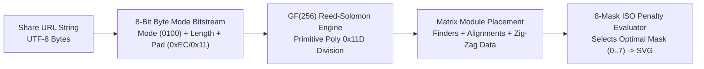

One of the core design principles of **[SurfZar](https://surfzar.vercel.app/)** is that it operates with **zero backend database**. When a professor, researcher, or digital artist crafts an algebraic surface with custom parameters $a, b, c, d$, dual-sided PBR textures, custom camera angles, cross-section clipping planes, and a 10-second multi-track keyframe animation, they should be able to share that exact studio state via a **single self-contained URL or QR code** that will still work 20 years from now.

Achieving that required solving two engineering problems in `src/lib/UrlState.ts` and `src/lib/QrCodeGenerator.ts`:
1. **Compact Delta-Encoded State Serialization (`UrlState.ts`)**: Compressing 40+ studio state fields and keyframe arrays so the URL fits comfortably inside QR Code Version 1–10 byte limits.
2. **A Zero-Dependency ISO/IEC 18004 QR Code Generator (`QrCodeGenerator.ts`)**: Implementing **Galois Field $\text{GF}(2^8)$ polynomial arithmetic**, **Reed-Solomon Error Correction**, and **ISO Mask Penalty evaluation** from scratch in ~350 lines of pure TypeScript.

---

## 1. Compact Key-Mapped & Delta-Pruned URL Serialization (`UrlState.ts`)

If you naively `JSON.stringify()` a Zustand store containing camera vectors, material presets, and animation tracks and Base64-encode it, even a simple sphere produces an 800+ character URL—exceeding the capacity of compact QR codes and getting truncated by messaging apps.

In `src/lib/UrlState.ts`, `serializeStateToUrl()` applies a three-stage compression pipeline:

1. **Default-Delta Pruning**: Any setting that matches the studio's default state (e.g., `roughnessA === 0.2`, `boundingShape === 'sphere'`, `shellThickness === 0`) is omitted completely from the payload.
2. **Float Quantization & Short-Key Dictionary (`CompactSharePayload`)**:
   Floating-point camera coordinates `[x, y, z]` and keyframe timestamps are rounded to 3 decimal places (`Math.round(v * 1000) / 1000`), and verbose property names are mapped to 1-to-3 character keys (`eq`, `a`, `b`, `c`, `d`, `m`, `cA`, `cB`, `bs`, `cam`, `kfs`).
3. **UTF-8 Safe URL-Base64 Encoding (`toUrlSafeBase64`)**:
   The resulting compact JSON string is UTF-8 byte-encoded and mapped to RFC 4648 URL-safe Base64 (`+` $\to$ `-`, `/` $\to$ `_`, stripping `=` padding), producing clean `#share=...` hashes under 180 characters.

---

## 2. Writing an ISO/IEC 18004 QR Code Generator from First Principles (`QrCodeGenerator.ts`)

Ironically, many mathematical apps that render 3D surfaces on the GPU pull in 50 KB+ of legacy CommonJS `<canvas>` dependencies just to draw a 2D QR code modal.

Because QR codes are themselves a beautiful application of **abstract algebra over finite fields**, I wrote `src/lib/QrCodeGenerator.ts` from scratch in pure TypeScript—producing crisp, resolution-independent `<svg>` markup with zero external packages.



### Step 1: Galois Field $\text{GF}(2^8)$ Log/Antilog Lookup Tables

Reed-Solomon error correction operates over the finite field $\text{GF}(256)$ (also written $\mathbb{F}_{2^8}$), where each byte $b \in [0, 255]$ represents a polynomial of degree $\le 7$ with binary coefficients in $\mathbb{F}_2[x]$ modulo the QR specification's irreducible primitive polynomial:

$$p(x) = x^8 + x^4 + x^3 + x^2 + 1 \quad (\text{hexadecimal } \mathtt{0x11d} = 285)$$

In $\text{GF}(2^8)$:
* **Addition and subtraction are both bitwise XOR (`^`)**, because $-1 \equiv +1 \pmod 2$.
* **Multiplication (`gfMul`)** modulo $p(x)$ is accelerated to $O(1)$ by precomputing the powers of the generator element $\alpha = 2$ into `GF_EXP` (antilog) and `GF_LOG` tables at module initialization:

```typescript
// Galois Field GF(256) with primitive polynomial 0x11d (x^8 + x^4 + x^3 + x^2 + 1)
const GF_EXP = new Uint8Array(512);
const GF_LOG = new Uint8Array(256);

(function initGF() {
  let x = 1;
  for (let i = 0; i < 255; i++) {
    GF_EXP[i] = x;
    GF_LOG[x] = i;
    x <<= 1;
    if (x & 0x100) x ^= 0x11d; // Reduce modulo p(x)
  }
  for (let i = 255; i < 512; i++) {
    GF_EXP[i] = GF_EXP[i - 255];
  }
})();

function gfMul(a: number, b: number): number {
  if (a === 0 || b === 0) return 0;
  return GF_EXP[GF_LOG[a] + GF_LOG[b]];
}
```

### Step 2: Reed-Solomon Generator Polynomial & Synthetic Division

To generate $k$ error-correction codewords (`eccLen`), we construct the Reed-Solomon generator polynomial $g(x)$ whose roots are $\alpha^0, \alpha^1, \dots, \alpha^{k-1}$:

$$g(x) = \prod_{i=0}^{k-1} \left(x - \alpha^i\right)$$

and compute the remainder of the message polynomial $M(x) \cdot x^k$ divided by $g(x)$ using polynomial synthetic division over $\text{GF}(256)$:

```typescript
function getGeneratorPoly(degree: number): Uint8Array {
  let g: Uint8Array = new Uint8Array([1]);
  for (let i = 0; i < degree; i++) {
    g = polyMul(g, new Uint8Array([1, GF_EXP[i]]));
  }
  return g;
}

function calculateEcc(data: Uint8Array, eccLen: number): Uint8Array {
  const gen = getGeneratorPoly(eccLen);
  const msg = new Uint8Array(data.length + eccLen);
  msg.set(data);

  for (let i = 0; i < data.length; i++) {
    const coef = msg[i];
    if (coef !== 0) {
      for (let j = 0; j < gen.length; j++) {
        msg[i + j] ^= gfMul(gen[j], coef);
      }
    }
  }
  return msg.slice(data.length);
}
```

### Step 3: Multi-Block Interleaving, Zig-Zag Placement & 8-Mask Penalty Scoring

For larger URLs (QR Versions 5–10), the payload is split across multiple Reed-Solomon blocks whose data and parity bytes are **interleaved** so a localized smudge on the QR code distributes bit errors evenly across blocks.

Finally, `QrCodeGenerator.ts`:
1. Places the three $7 \times 7$ **Finder Patterns**, **Timing Strips**, **Dark Module**, and version-specific **Alignment Patterns** on the $N \times N$ matrix while marking them in a `reserved` mask.
2. Snakes the interleaved bitstream upward and downward in 2-column **Zig-Zag strips** from the bottom-right corner (skipping vertical timing column $x = 6$).
3. Evaluates all **8 ISO data masks** (`mask 0` through `mask 7`) against the four ISO/IEC 18004 penalty rules (runs of $\ge 5$ identical bits, $2 \times 2$ solid blocks, false finder-like `1:1:3:1:1` patterns, and dark/light balance ratio), selects the mask with the lowest penalty score, writes the BCH-encoded 15-bit format string, and emits a single compact `<svg><path d="..."/></svg>` element!
