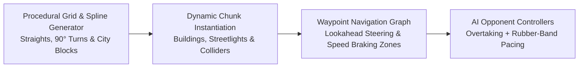

Back in 2010, during university game development and computer graphics courses at ITBA, I built two 3D games in **C# and Unity 3D**: [**City Racing**](https://www.kongregate.com/games/daniazar/city-racing) (which went on to accumulate over **10,000 plays on Kongregate**) and [**Asteroids Deluxe**](https://daniazar.github.io/ITBA-asteroids/).

Both projects were exercises in squeezing maximum replayability out of lightweight procedural systems and custom camera/physics controllers.

---

## 1. City Racing: Infinite Procedural Road Networks & Spline AI

In traditional arcade racing games, level designers spend weeks hand-modeling static tracks. For [**City Racing**](https://github.com/daniazar/ITBA-CityRace), we wanted every single race to take place on a newly generated urban circuit without ever hitting a dead end or self-intersecting road block.

### Procedural Track & City Block Generation
- **Tile & Spline Continuity**: As the player's car advanced, the track generator stitched modular road segments (straights, curves, intersections) and populated surrounding city blocks with randomized building prefabs and street props, recycling behind-camera chunks to keep memory flat.
- **Waypoint-Driven AI Opponents**: Because the track didn't exist before runtime, AI opponents couldn't rely on pre-baked navmeshes. Each spawned road segment automatically registered entry, apex, and exit waypoints; AI cars calculated steering torque toward the next apex while modulating throttle based on upcoming turn curvature.

When we published **City Racing** to [**Kongregate**](https://www.kongregate.com/games/daniazar/city-racing), over **10,000 players** raced across its procedural city circuits.

---

## 2. Asteroids Deluxe: Dual-Perspective 2D Classic vs. 2.5D Chase Camera

For [**Asteroids Deluxe**](https://github.com/daniazar/ITBA-asteroids), the goal was to take Atari's 1979 vector classic and reimagine how perspective changes spatial awareness without altering the underlying Newtonian drift physics:

- **2D Classic Orthographic Mode**: A top-down orthographic camera replicating the classic arcade wrap-around playfield where players judge asteroid trajectories across all 360 degrees simultaneously.
- **2.5D Third-Person Chase Mode**: With a single keypress, the camera smoothly interpolated behind the spacecraft into a 3D perspective chase view. Firing thrusters and weaving through rotating 3D asteroid fields suddenly felt like a cockpit dogfight, even though the rigid-body momentum and toroidal screen-wrapping rules remained identical under the hood.

In 2016, I migrated the original Unity 2.x/3.x C# codebases to Unity 5 WebGL so [**Asteroids Deluxe can be played directly in modern browsers**](https://daniazar.github.io/ITBA-asteroids/).
