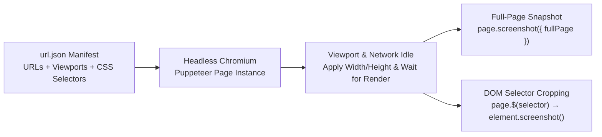

Whether you are generating visual regression snapshots across environments, archiving marketing pages, or extracting specific UI widgets for documentation, manually taking and cropping browser screenshots quickly becomes tedious.

To automate this workflow, I built [**WebScreen (`daniazar/webscreen`)**](https://github.com/daniazar/webscreen)—a declarative, JSON-driven screenshot engine written in **TypeScript** on top of **Headless Chrome and the Puppeteer API**.

---

## Declarative Capture via `url.json`

Instead of writing custom imperative Puppeteer scripts every time you need to capture a new site or component, **WebScreen** reads a declarative `url.json` manifest where each entry specifies:
- **Full-Page or Viewport Capture** (`fullPage`, `capturePage`, custom `viewport.width` $\times$ `viewport.height`).
- **Targeted DOM Element Crops (`elements`)**: An array of CSS selectors (`.class` or `#id`) that WebScreen locates in the live DOM, computes bounding boxes for, and exports as isolated image files.
- **Output Format (`extension`)**: Supports lossless `png` or compressed `jpeg` output.

```json
[
  {
    "url": "https://github.com/",
    "name": "github",
    "fullPage": true,
    "capturePage": true,
    "elements": [
      ".home-hero-signup"
    ],
    "extension": "jpeg"
  },
  {
    "url": "https://google.com/",
    "viewport": {
      "width": 300,
      "height": 400
    },
    "capturePage": true,
    "elements": [
      ".content",
      "#hplogo"
    ]
  }
]
```

---

## How the Capture Pipeline Works



For each target in `url.json`:
1. **Viewport Configuration**: If a custom `viewport` is defined (e.g., `300x400` to simulate a mobile device), WebScreen resizes the headless browser tab before navigation so responsive media queries trigger accurately.
2. **Page-Level Capture**: When `capturePage: true` is enabled, it captures either the visible viewport or the stitched `fullPage` scroll height.
3. **Sub-Element Isolation**: It iterates through the `elements` array, queries each CSS selector via `page.$(selector)`, and renders an exact bounding-box screenshot of that DOM node (`github_0.jpeg`, `google_1.png`, etc.).

The repository and documentation are available on GitHub at [**github.com/daniazar/webscreen**](https://github.com/daniazar/webscreen).
